# 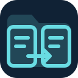 FileExplorer

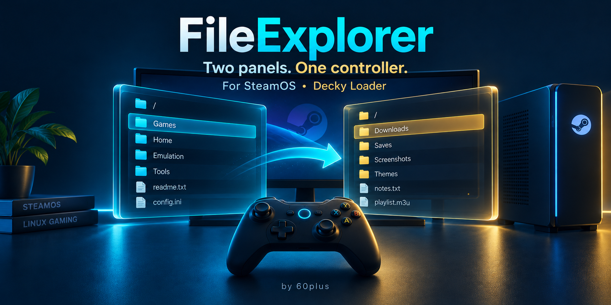

A simple, controller-friendly file manager for **SteamOS and Decky Loader**.
Open two folders side by side, select your files and copy them across.

[User manual](https://github.com/60plus/Decky-FileExplorer/wiki) ·
[How it works](https://github.com/60plus/Decky-FileExplorer/wiki/How-It-Works) ·
[Troubleshooting](https://github.com/60plus/Decky-FileExplorer/wiki/Troubleshooting)

## What it does

- **Two panels** with independent folders and selections. On handhelds and smaller screens, the window fills the available space between Steam's header and controller controls.
- **Gamepad controls** with Steam's controller glyphs and a permanent button legend.
- **Copy files and folders** between local disks and SMB shares, with percentage, transfer speed and cancellation.
- **Background transfers through systemd** keep copying or extracting after closing FileExplorer. Plugin notifications report 25%, 50%, 75% and completion while the window is closed.
- **Open ZIP, RAR, 7z and TAR archives like folders**, select their contents and extract them to the other panel, using SteamOS's libarchive.
- **Discover SMB servers and list their shares** from the connection dialog.
- **Browse SMB2 shares**, including guest access and username/password/domain authentication.
- **Remember SMB connections** when requested. Previously connected shares can be reopened without entering the password again.
- **Browse mounted network shares**, including NFS and desktop GVFS mounts, as ordinary folders.
- **Rename, create folders and select multiple files** from the Options menu.
- **Move local files to Trash** and restore them in Desktop Mode. **Empty Trash** is available in Options and Settings with a separate confirmation. SMB deletion is permanent.
- **Edit small text files** such as TXT, CFG, INI, JSON, XML and scripts, preserving their existing formatting and encoding.
- **Preview BMP, PNG, JPEG, GIF and WebP images** fitted to the available space. Left/right switches between images in the current folder, including SMB and archive folders.
- **Select and copy text with the controller**, paste through Steam's keyboard and undo with Menu/Start. The whole editor fits above the keyboard.
- **Customize the appearance** with six accent colors, background opacity, four text sizes and 70% to 100% interface scaling. The window keeps its size while smaller controls leave more room for content.

The Decky sidebar contains **Launch FileExplorer**, **Settings**, **Update** and **About**.
Settings, Update and About stay inside the compact sidebar. **Update** checks the latest stable GitHub release,
shows its release notes, verifies the download and opens Decky's installation prompt.
Startup checks notify once per OS boot when a newer version is available. Disable them in Settings if preferred.

## See it in action

| PC | Handheld |
| --- | --- |
| [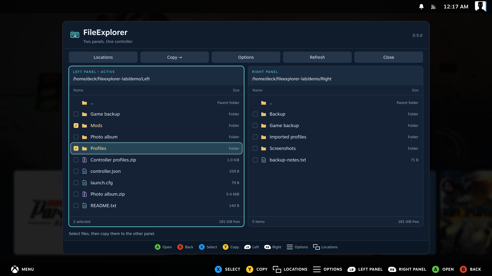](images/screenshots/01-two-panels-c446ee4897f4.png) | [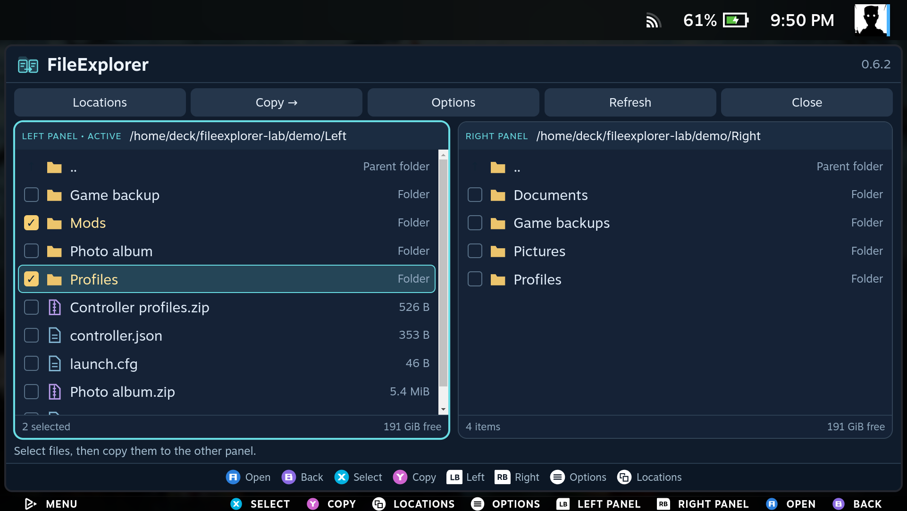](images/screenshots/handheld-01-two-panels-c2e9c0a15101.png) |
| Browse and copy between two folders. | The same controls, fitted to the handheld screen. |
| [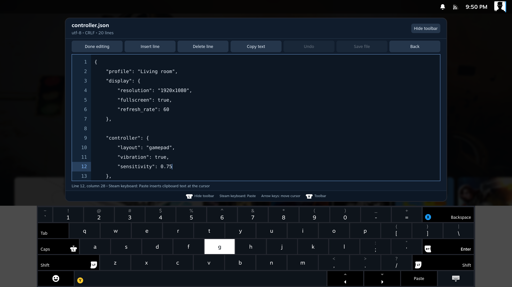](images/screenshots/04-keyboard-34fba006255f.png) | [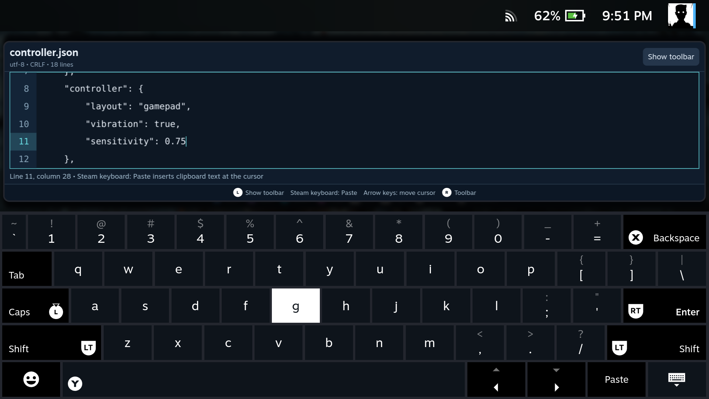](images/screenshots/handheld-16-scaled-keyboard-e93ef9e92a7a.png) |
| Keep the edited text visible above the keyboard. | Smaller controls and a hidden toolbar leave more room for text. |

Expand a gallery below for more screenshots from SteamOS Gaming Mode.
Click any image to open it at full size. Full galleries: [PC](docs/SCREENSHOTS.md)
and [handheld](docs/wiki/Handheld-Gallery.md).

<details>
<summary><strong>PC</strong></summary>

These captures show the installed plugin on a SteamOS PC, using demonstration files.


| Browse archives like folders | Edit configuration files |
| --- | --- |
| [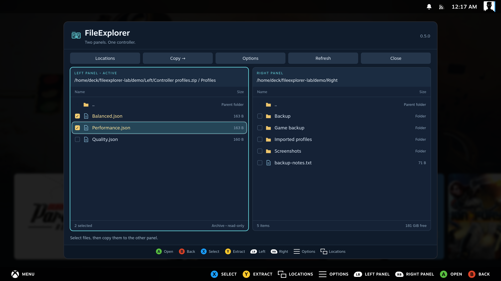](images/screenshots/02-archive-browsing-63332a829c46.png) | [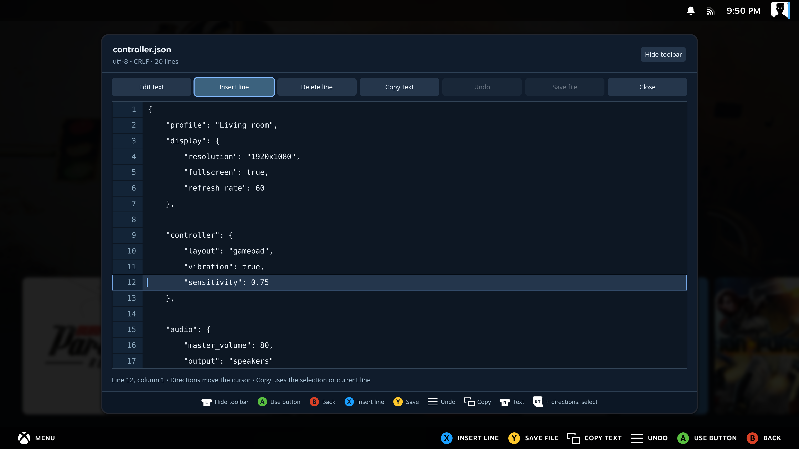](images/screenshots/03-text-editor-d668bc2ac194.png) |
| Open an archive with **A**, select with **X**, extract with **Y**. | Keep indentation, blank lines, encoding and line endings. |

| Keep the edited line visible | Watch progress and speed |
| --- | --- |
| [](images/screenshots/04-keyboard-34fba006255f.png) | [](images/screenshots/05-copy-progress-574110153ac8.png) |
| Make changes with the controller and Steam's keyboard. | See how much has copied and how fast it is moving. |

| Close the panel and carry on | Add a network share |
| --- | --- |
| [](images/screenshots/06-background-notification-6d5018c7b427.png) | [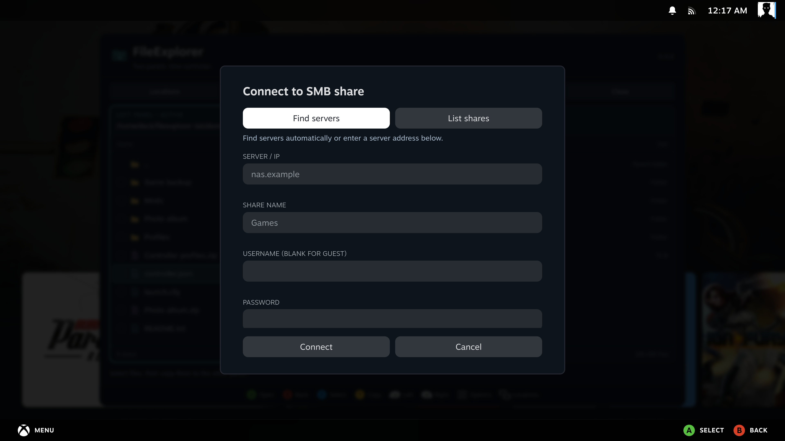](images/screenshots/07-network-share-982884978b24.png) |
| Background operations report **25%, 50%, 75% and done**. | Find servers, list shares and optionally remember the login. |

| File actions within reach | Clear confirmation before emptying Trash |
| --- | --- |
| [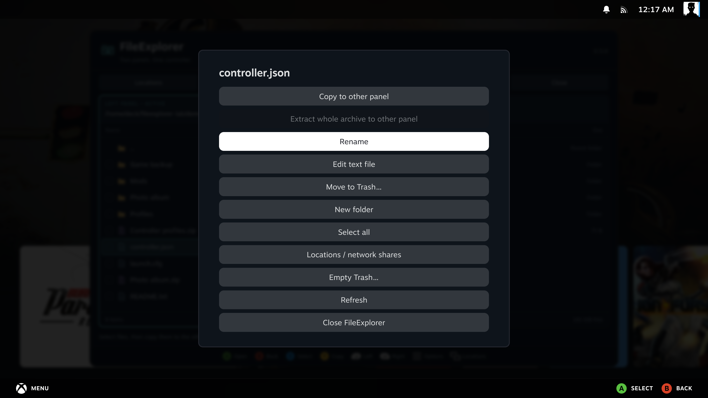](images/screenshots/08-file-options-218d6cc6a81f.png) | [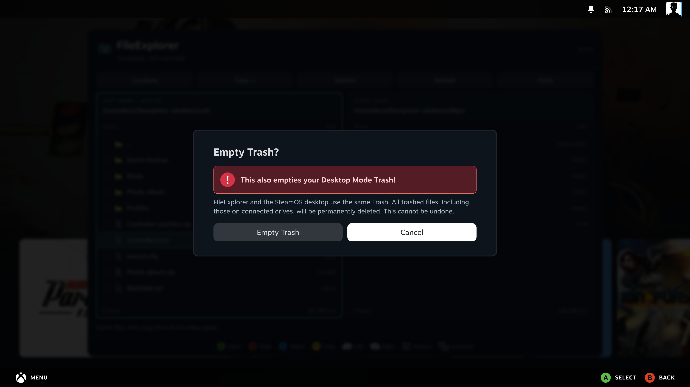](images/screenshots/09-trash-warning-b01f844c3656.png) |
| Open **Options** for rename, edit, copy and folder actions. | The warning explicitly includes the **Desktop Mode Trash**. |

| Make it your own | Select and copy text |
| --- | --- |
| [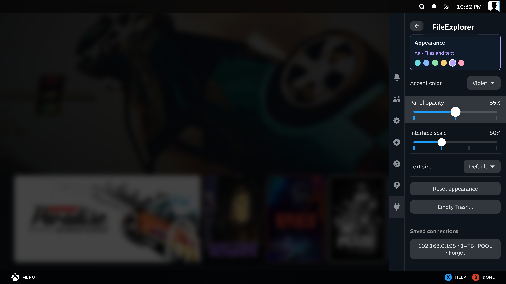](images/screenshots/11-appearance-settings-7c09f0487bdf.png) | [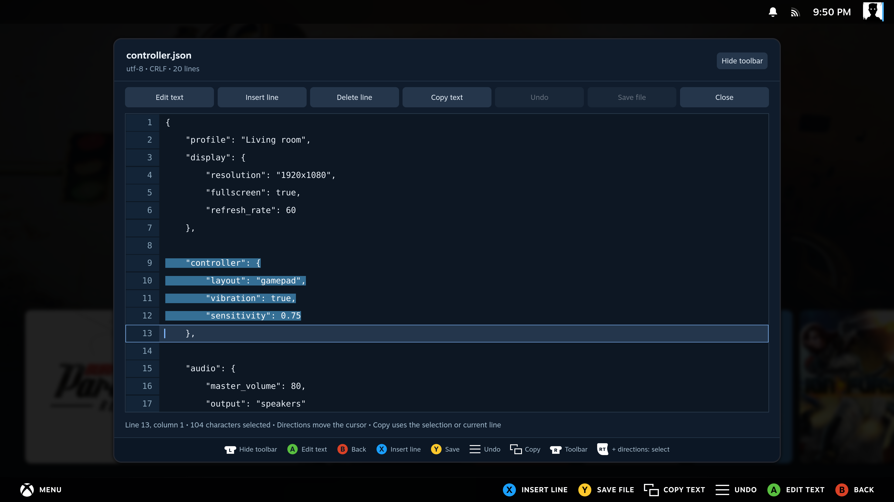](images/screenshots/12-text-selection-2b7cce3b86f0.png) |
| Choose an accent color, background opacity and text size. | Hold **RT/R2 + directions**, copy with **View/Select**, paste with Steam's keyboard. |

| Open pictures without leaving Gaming Mode | Preview images inside an archive |
| --- | --- |
| [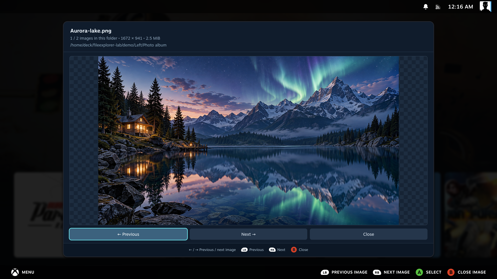](images/screenshots/13-image-viewer-b9b28a6b4bd2.png) | [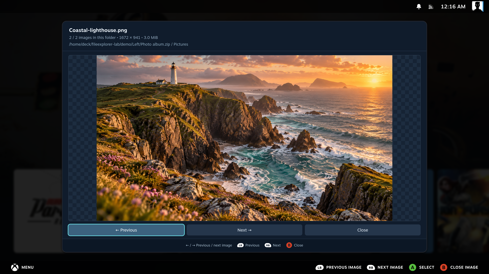](images/screenshots/14-archive-image-ef37a7c65758.png) |
| Press **A** to open; **left/right** or **L1/R1** changes the image. | Open the ZIP, enter its picture folder and press **A** on an image. |

**Network discovery.** Real servers found on the local test network.

[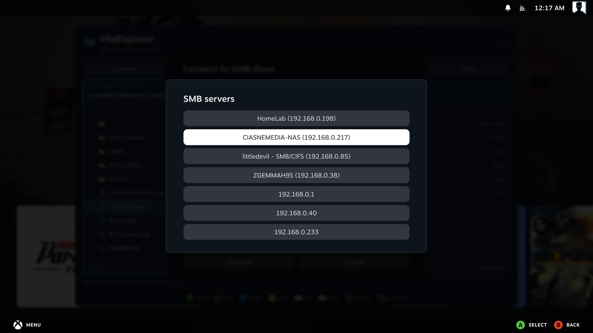](images/screenshots/10-smb-discovery-be509db9bd73.png)

| Check the latest GitHub release | Control startup notifications |
| --- | --- |
| [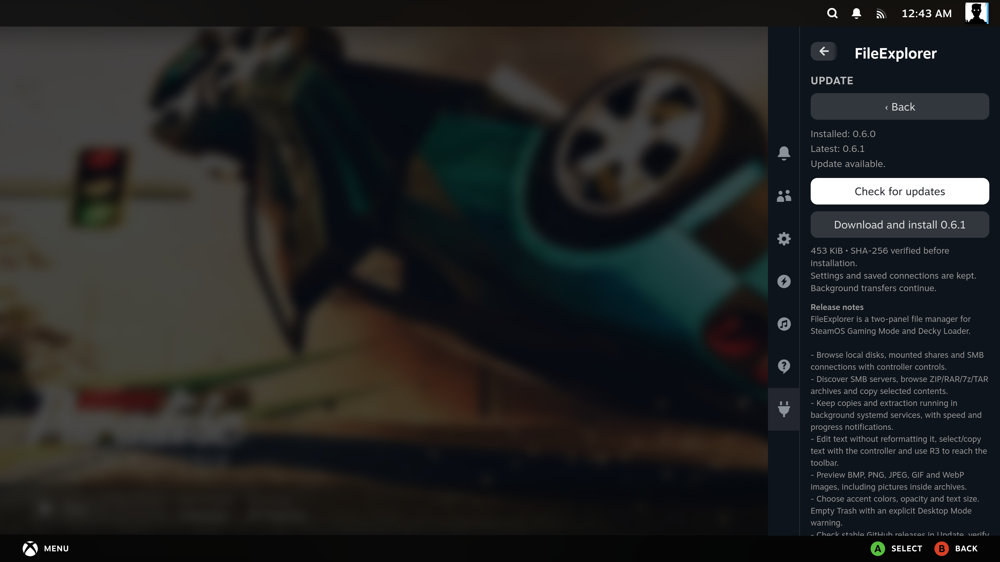](images/screenshots/15-github-update-f2b9d6244506.png) | [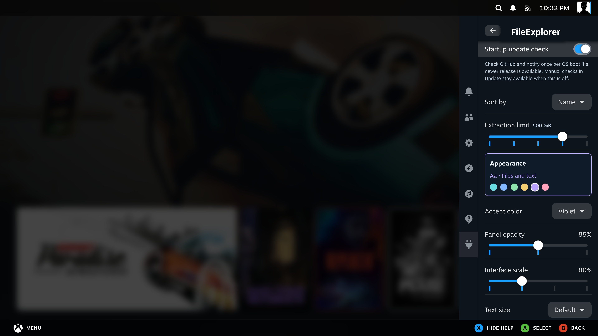](images/screenshots/17-update-settings-a8b877f12651.png) |
| Read the release notes, download and confirm in Decky. | Notify once per OS boot; manual checks work with this option off. |

</details>

<details>
<summary><strong>Handheld</strong></summary>

These captures come from a **ROG Ally running SteamOS**. Browse the
[handheld gallery](docs/wiki/Handheld-Gallery.md) for archives, text selection,
images, network discovery and settings.

| Full window with two panels | More text above the keyboard |
| --- | --- |
| [](images/screenshots/handheld-01-two-panels-c2e9c0a15101.png) | [](images/screenshots/handheld-16-scaled-keyboard-e93ef9e92a7a.png) |
| The window fills Steam's available space. | Choose **80% Interface scale** and press **L3** to hide the toolbar. |

</details>

## Controls

Steam renders the matching glyphs for the active controller. The names below use Xbox / Steam Deck labels.

| Button | Action |
| --- | --- |
| D-pad / left stick | Navigate files and buttons |
| A | Open a folder, archive, text editor or image; confirm |
| B | Parent folder; close at the filesystem/share root |
| X | Select or deselect the focused item |
| Y | Copy the selection; inside an archive, extract selected contents |
| L1 / LB | Focus the left panel |
| R1 / RB | Focus the right panel |
| Start / Menu | File and folder options |
| View / Select | Locations, mounted drives and SMB connections |

Copy uses the selected items, or the focused item if nothing is selected.
Mouse users can click to focus, double-click to open and click the square to select.
Steam's text fields support its on-screen keyboard for names and connection details.

## Network shares

Open **Locations → Add SMB share → Find servers**, choose a server, then use **List shares**.
Enter login details before listing shares if the server requires them. Credentials are sent only to the server you choose.
You can also enter a server name or IP and share name manually.
Leave username/password blank for a guest share. Domain is optional.

Discovery combines advertised SMB services with a bounded TCP 445 scan on directly connected private IPv4 LANs.
It checks up to 512 addresses; on networks larger than /24 it scans the computer's local /24.
Servers on other subnets or hidden by a firewall can be entered manually. A detected open port does not guarantee guest access.

Enable **Remember connection** to save the connection for future sessions.
Credentials are stored in the plugin's settings directory with directory mode `0700` and file mode `0600`.
They are not encrypted against other programs running as the same Steam user.
They are never returned by the settings API. Use **Settings → Saved connections → Forget** to remove them.

Existing operating-system mounts appear in Locations and reuse the operating system's established session.
FileExplorer does not read passwords from KDE Wallet or change `/etc/fstab`.
Direct SMB connections use SMB2 and NTLMv2 on TCP 445; servers requiring SMB3 encryption are not supported in this version.
Unmounted NFS shares should first be mounted through SteamOS/Desktop Mode.

## Settings

- Check GitHub for updates at startup and notify once per OS boot (enabled by default). Manual checks remain available.
- Show hidden files, including dot files and the SMB hidden attribute.
- Show folders first.
- Sort by name, size or last modification.
- Remember the folders open in both panels.
- Limit the unpacked size of each archive: 10, 50, 100 or 500 GiB, or choose **Unlimited**.
- Choose cyan, blue, green, amber, violet or rose accents, 70/85/100% background opacity and four text sizes.
- Use **Interface scale** to fit more content while keeping the window full size.
- Empty the SteamOS Trash, including trash on connected drives. This permanently deletes trashed items.

Opacity, interface scale and extraction limit use sliders. Press **X** on a
setting for its explanation; **up/down** closes the help and moves to the next
setting. Descriptions stay hidden until needed.

## Install

Download the **FileExplorer plugin ZIP** from the [latest release](https://github.com/60plus/Decky-FileExplorer/releases/latest).
Use the plugin ZIP, not the source-code archive.

1. Open Decky Loader settings and enable **Developer mode**.
2. Select **Developer → Install Plugin from ZIP File**.
3. Choose the downloaded ZIP and confirm installation.
4. Open **FileExplorer → Launch FileExplorer**.

Decky also accepts a direct plugin ZIP link under **Install Plugin from URL**.
See the [illustrated installation guide](https://github.com/60plus/Decky-FileExplorer/wiki/Installation)
for both methods and the Developer-mode screenshots.

## Update

Open **FileExplorer → Update → Check for updates**, then choose **Download and install**.
The plugin verifies the GitHub ZIP before opening Decky's installation prompt.
Confirm **Install** there. Settings, saved connections and running transfers are preserved.
Updates contain the complete plugin, so intermediate releases are not required.

See the [update guide](https://github.com/60plus/Decky-FileExplorer/wiki/Installation#update-an-existing-installation)
for the complete workflow.

## File handling

FileExplorer runs as the Steam user, without root privileges.
Transfers run in a separate systemd user service. Closing the window or reloading the plugin does not cancel them.
The active window shows progress and speed; when it is closed, FileExplorer posts notifications with its icon at each quarter and at completion.
Notifications require Steam and Decky to be running. Reopening the window reconnects to the current operation.
Shutdown or reboot interrupts a transfer; this version does not resume an interrupted transfer automatically.
Speed measures bytes processed by the current stage, including temporary staging when extracting selected archive contents.

Existing files are not overwritten: a name conflict stops the operation and keeps completed items.
Files are copied into a temporary name in the destination and renamed after completion.
An interrupted network connection can leave a hidden `.fileexplorer-*.partial` item, which can be removed after reconnecting.

Press **A** on an archive to browse its folders. **B** returns to the parent folder, including out of the archive root.
Select files or folders with **X**, then press **Y** to extract those items directly into the other panel, locally or on SMB.
The archive stays unchanged. An archive open in the destination panel is read-only.
Selected extraction uses temporary disk space; archives on SMB are downloaded temporarily for reading.
The separate **Extract whole archive** option creates a new folder in a local destination.
To browse an archive nested inside another archive, first extract that inner archive to a normal folder.
Absolute paths, traversal, links and special files are rejected. There is a 100,000-entry limit as well as the configured byte limit.
Password-protected and multipart archives are not supported. Some uncommon RAR compression methods may not be supported by the system library.
Copying symbolic links or special files is refused. A copy preserves file contents and folder structure; it is not a backup of ownership, permissions, ACLs or extended attributes.

## Text editor

Press **A** on a text file, or choose **Options → Edit text file**. Navigate to a line and press **A** to edit it.
The whole editor shrinks above Steam's on-screen keyboard, with the current line and surrounding text visible.
**X** inserts a line with the same indentation; **Y** saves; **Menu/Start** undoes a recent edit.
Press **R3** (click the right stick) to switch between the text and the toolbar.
Move left/right across toolbar buttons, confirm with **A**, and use **R3** or **Down** to return to the cursor.
R3 also closes an open keyboard and focuses the toolbar.
Press **L3** (click the left stick) to hide or show the toolbar and leave more room
for text, including while Steam's keyboard is open. **R3** shows a hidden toolbar
when you need its buttons. **Settings → Interface scale** can make all controls in
the file manager, editor and image viewer smaller without shrinking their windows.
With the keyboard hidden, hold **RT/R2 + directions** to select text and press **View/Select** to copy the selection or current line.
Press **A** at the destination and use Steam's native **Paste**. Changes stay in memory until Save; closing with unsaved changes asks before discarding them.

The editor keeps spaces, tabs, blank lines, existing line endings (including mixed endings), the final newline, BOM and original encoding.
It does not run a formatter or reserialize the document. JSON syntax is checked before saving, with an invalid line highlighted;
other formats retain their text layout but do not have a syntax validator.
UTF-8 and BOM-marked UTF-16 are detected automatically. For older files, choose the original encoding explicitly.
Unsupported characters, external file changes, binary files and files larger than 512 KiB are refused instead of silently replacing data.
The editor supports up to 10,000 lines. Files inside archives must be extracted before editing.
SMB editing uses a temporary replacement and backup; after a connection failure, check any reported backup before retrying.

## Image viewer

Press **A** on a BMP, PNG, JPEG, GIF or WebP file to open the image viewer.
Use **left/right** or **L1/R1** to browse the other images in the same folder; **B** returns to the file list.
The viewer follows the panel's sorting and hidden-file settings and wraps at either end.
It works with local files, existing mounts, SMB shares and images inside browsable archives.
The original file is unchanged. Preview limits are **20 MiB**, **40 megapixels** and **16,384 pixels per side**.
See the [illustrated image-viewer guide](https://github.com/60plus/Decky-FileExplorer/wiki/Image-Viewer).

**Empty Trash** displays a red warning: it also empties the same Trash used in **Desktop Mode**, including connected drives.
The confirmation is required because this permanently deletes the trashed items.

## Build

Use Node.js with pnpm, and Python 3.10 or newer:

```sh
pnpm install --frozen-lockfile
python3 -m pip install --target vendor -r requirements.txt
pnpm typecheck
node --test tests/editor-text.mjs
pnpm build
python3 -m unittest discover -s tests -v
python3 scripts/package.py
```

The installable ZIP and SHA-256 checksum are written to `out/`.
The archive tests use Linux's system libarchive. Runtime Python dependencies are included in the plugin ZIP.
See [verification notes](docs/TESTING.md) for the tested environment and coverage.
The manual source is in [docs/wiki](docs/wiki/Home.md); see
[maintaining the wiki](docs/WIKI.md) for publishing matching documentation updates.

Built with [Decky API and UI](https://github.com/SteamDeckHomebrew/decky-plugin-template),
[pysmb](https://github.com/miketeo/pysmb) and the system [libarchive](https://www.libarchive.org/).
MIT license. Dependency licenses are included with their distributions in the plugin bundle.
The 60plus author logo is supplied by the repository owner and is not covered by the source-code MIT license.
