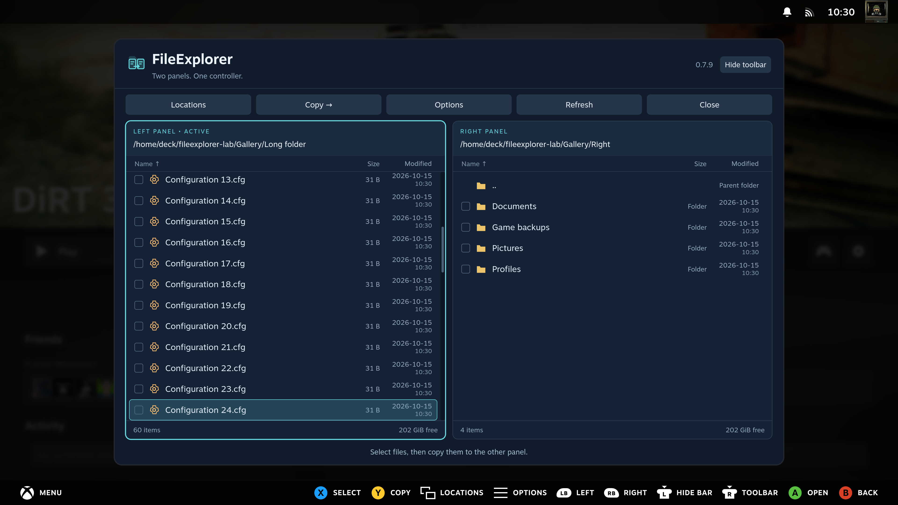
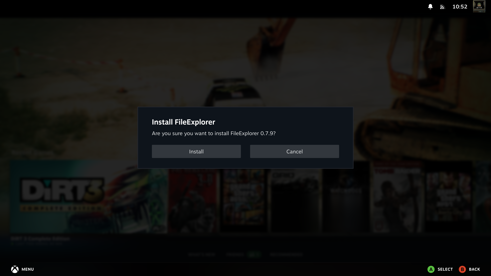
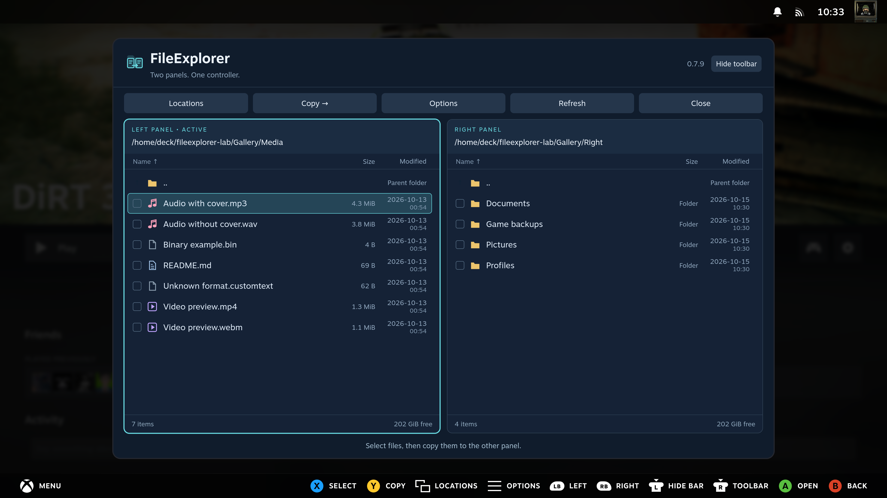
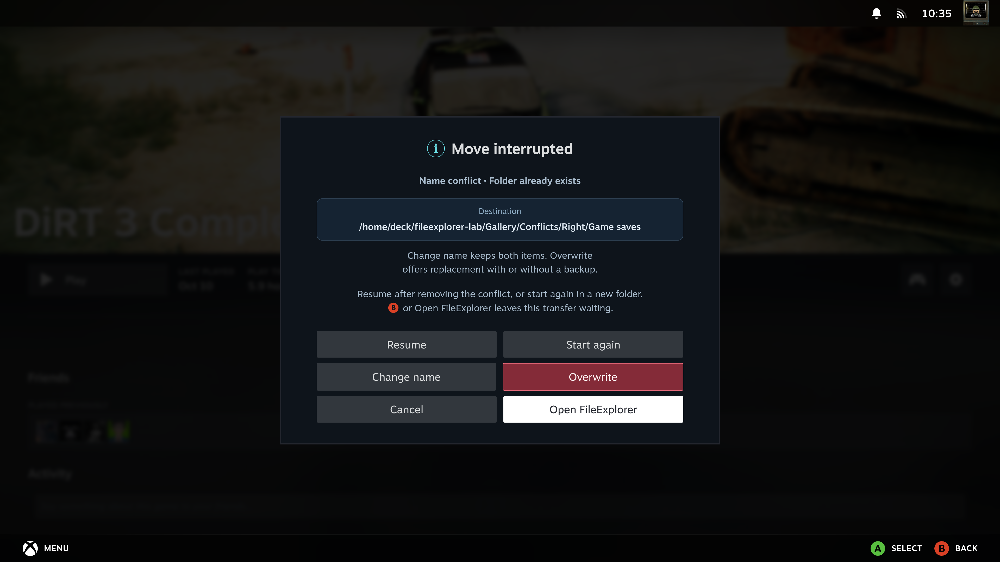

# FileExplorer screenshot gallery

FileExplorer, captured in Steam Gaming Mode on a SteamOS PC on 15 October 2026.
These are unedited screenshots of the installed plugin, using demonstration files in
`/home/deck/fileexplorer-lab` and real SMB discovery results from the test LAN.
Controller glyphs are supplied by Steam. These captures use the Steam PC profile:
100% interface scale, an opaque panel and controller hints only on Steam's bottom bar.
The explicitly labelled legend comparison retains its earlier four-mode captures.

Screenshots are refreshed when the layout or demonstrated behavior changes.
A different version number alone does not require a new gallery.

[Back to the README](../README.md)

See also the [handheld gallery](wiki/Handheld-Gallery.md), captured on a ROG Ally
running SteamOS, including interface scaling and the editor's L3 toolbar toggle.

## First setup

Choose a profile and review its settings. The handheld wizard fills the available
space; its settings scroll above fixed Save and Back buttons.

The centered splash appears once for three seconds; repeat displays are off by default.

Press the controller Help button on any setup setting for its explanation.

## Long file lists

The dark, rounded scrollbar matches the file panels. Controller navigation keeps
the focused file visible; the other panel can stay at its own position.

## Update from GitHub

Check the latest stable release, read the release notes and download the update.
The ZIP is verified before Decky opens its installation prompt.

The development build in this capture is newer than the public release, so the
check correctly reports that no update is needed. Download controls appear when
a newer public version is available. The installation prompt below uses the
current local plugin ZIP and was cancelled after capture.

Startup checks can notify once per OS boot. The Settings switch disables automatic
checks and notifications while keeping manual updates available.

## Two file panels

Keep the source and destination side by side. Select multiple files or folders with **X**,
then copy them to the other panel with **Y**. The bottom legend stays visible.

The **Modified** column shows local dates and times. **Options → Sort by…**
chooses name, size or newest-first dates for both panels.

## Open archives like folders

Browse into a ZIP, select the profiles you want and extract those items into the other panel.
The archive remains unchanged. ZIP, RAR, 7z and TAR use the same browsing workflow.

## Edit text while keeping its layout

Line numbers, a highlighted active line and controller shortcuts make small configuration
changes possible without leaving Gaming Mode. Formatting and encoding are retained;
JSON also receives a syntax check before saving. The example shows a JSON file with CRLF endings.
Press **R3** to reach the toolbar and again to return to the cursor.

## See the line above the keyboard

Press **A** to edit. The whole editor panel shrinks above Steam's on-screen keyboard,
keeping the toolbar, current line, nearby text and status visible.

## Follow a transfer at a glance

The open window shows the percentage, copied bytes, total size, speed and current filename.
This screenshot uses a real copy of demonstration data. Demo workers were held
briefly to capture the controls; the displayed speed is a recorded reading, not
a performance measurement.

## Let it finish in the background

Copying continues after closing FileExplorer. Native Steam notifications use the
plugin's icon and report quarter milestones plus completion. The example notification
at the bottom right comes from extracting the demonstration Game backup archive.

## Find servers on your network

Choose **Locations → Add SMB share → Find servers** to discover SMB servers without
typing their addresses. This capture shows seven real results from the test LAN,
including advertised device names and local IP addresses. Select a server to fill
the connection form, then use **List shares** to choose a share.

## Reach your network shares

The connection dialog offers **Find servers** and **List shares**, manual server/share
entry, optional credentials and a Remember connection option further down the form.
The form is shown before entering login details; no connection was submitted.

## Common file actions in one menu

Open **Options** to copy, rename, edit text, create a folder or move local files to Trash.
Actions that do not apply to the selected item are disabled.

## Know which Trash will be emptied

A red warning explains that FileExplorer and Desktop Mode share the same Trash.
The dialog was cancelled after this screenshot; no user files were deleted.

## Customize the appearance

Choose an accent color, background opacity and text size in the compact Decky sidebar.
Reset appearance restores the default look without changing folders or connections.
Opacity, interface scale and extraction limit use full-width sliders. Press **X**
to expand help for the focused setting; moving up/down hides it again.

## Select and copy text with the controller

Hold **RT/R2** while moving in the text to select a fragment or several lines.
**View/Select** copies into the system clipboard. Use Steam's keyboard to paste,
and **Menu/Start** to undo an edit.

## View pictures in Gaming Mode

Press **A** to open an image. Use **left/right** or **L1/R1** to switch pictures
without returning to the file list. The header shows the filename, image counter,
dimensions and file size. The lake artwork was generated for this demonstration;
the screenshot is an unedited capture of the installed SteamOS plugin.

## Look inside an archive of pictures

The image viewer also works inside archive folders. Only the chosen image is
extracted temporarily, and the source archive is unchanged. The second capture
shows another image selected from the demonstration ZIP.

## Media, recovery and controller hints

## Compare controller legends

Panel only, Steam bar only, both and hidden. Four native captures arranged side by side.

## Moving, packing and Steam integration

## Copy queue and parallel progress

Each task has its own progress. Choose up to five copies, or queue the selection after existing tasks.

## Recover unsaved text

Restore a saved draft after interruption, keeping the original file unchanged until Save.

## Name conflicts and grouped Options

File actions and folder controls occupy separate columns. Copy and move conflicts use six actions, with a separate backup or overwrite confirmation.

