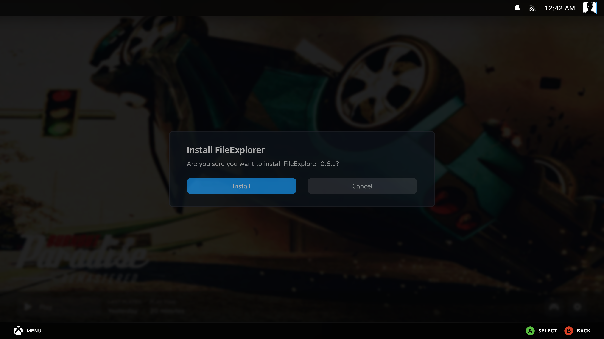
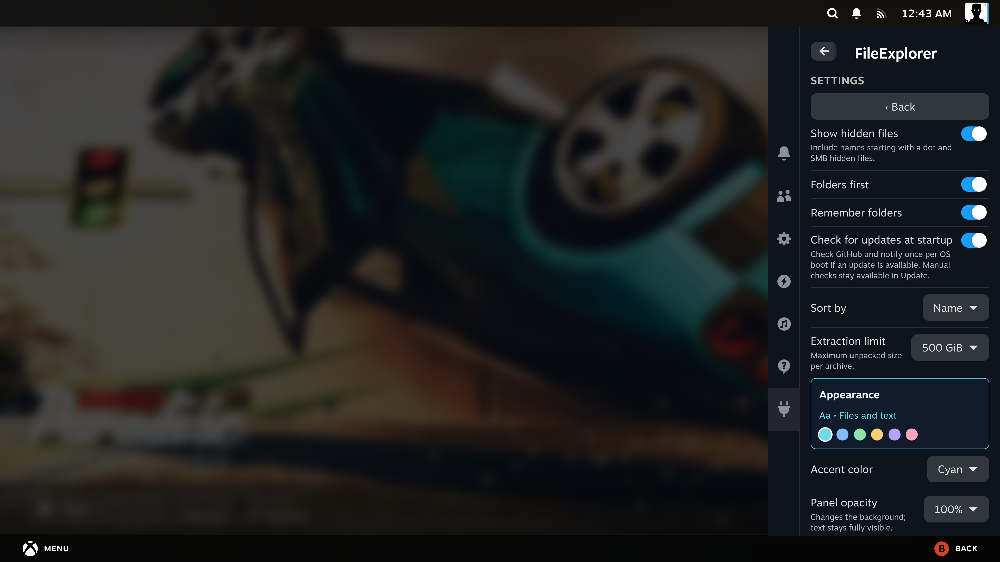
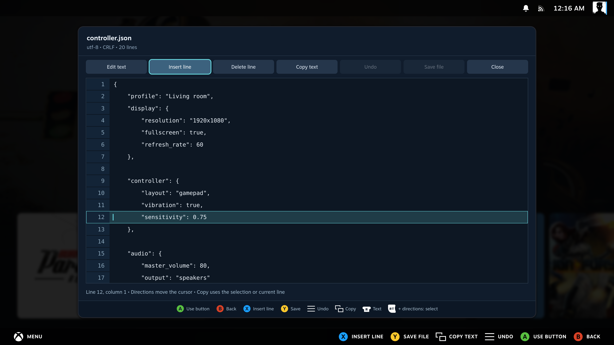
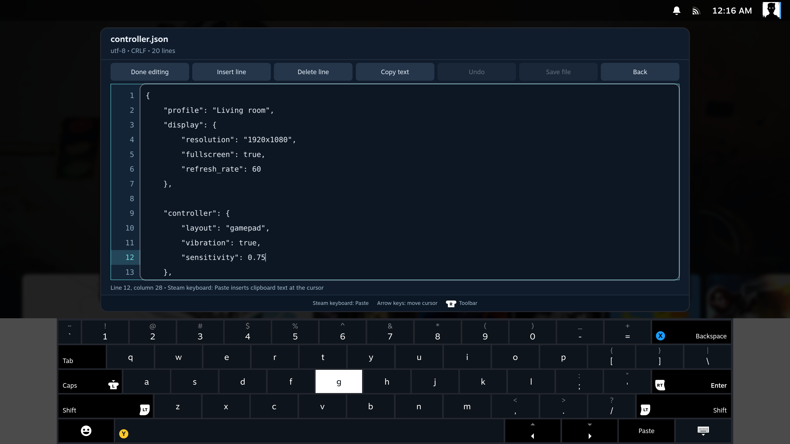
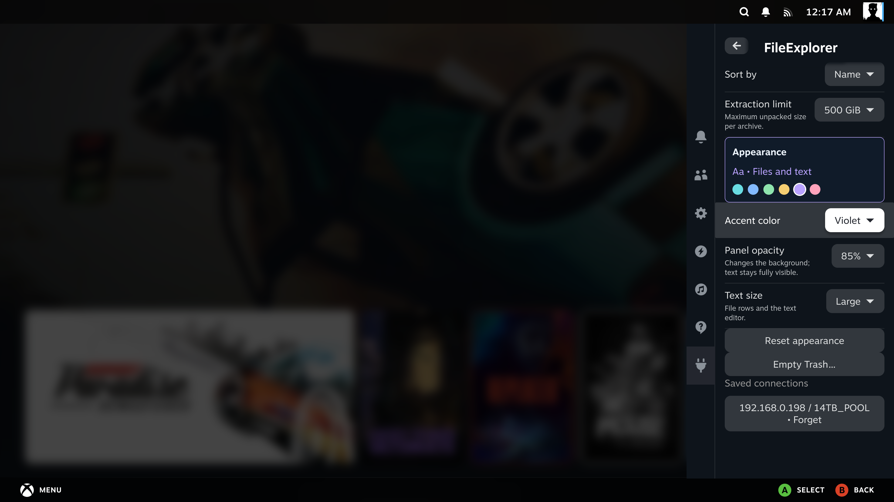
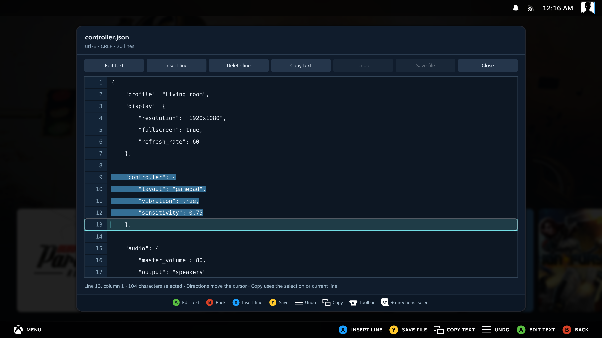

# FileExplorer screenshot gallery

FileExplorer, captured in Steam Gaming Mode on a SteamOS PC on 12 October 2026.
These are unedited screenshots of the installed plugin, using demonstration files in
`/home/deck/fileexplorer-lab/demo` and real SMB discovery results from the test LAN.
Controller glyphs are supplied by Steam.

[Back to the README](../README.md)

## Update from GitHub

Check the latest stable release, read the release notes and download the update.
The ZIP is verified before Decky opens its installation prompt.

Startup checks can notify once per OS boot. The Settings switch disables automatic
checks and notifications while keeping manual updates available.

## Two folders, one controller

Keep the source and destination side by side. Select multiple files or folders with **X**,
then copy them to the other panel with **Y**. The bottom legend stays visible.

## Open archives like folders

Browse into a ZIP, select the profiles you want and extract those items into the other panel.
The archive remains unchanged. ZIP, RAR, 7z and TAR use the same browsing workflow.

## Edit text while keeping its layout

Line numbers, a highlighted active line and controller shortcuts make small configuration
changes possible without leaving Gaming Mode. Formatting and encoding are retained;
JSON also receives a syntax check before saving. The example shows a JSON file with CRLF endings.
Press **R3** to reach the toolbar and again to return to the cursor.

## See the line above the keyboard

Press **A** to edit. The whole editor panel shrinks above Steam's on-screen keyboard,
keeping the toolbar, current line, nearby text and status visible.

## Follow a transfer at a glance

The open window shows the percentage, copied bytes, total size, speed and current filename.
This screenshot was taken during a real copy of generated demo data. The speed is an
instantaneous reading on the test PC, not a performance promise.

## Let it finish in the background

Copying continues after closing FileExplorer. Native Steam notifications use the
plugin's icon and report quarter milestones plus completion. The example notification
at the bottom right comes from copying the demo Game backup folder.

## Find servers on your network

Choose **Locations → Add SMB share → Find servers** to discover SMB servers without
typing their addresses. This capture shows seven real results from the test LAN,
including advertised device names and local IP addresses. Select a server to fill
the connection form, then use **List shares** to choose a share.

## Reach your network shares

The connection dialog offers **Find servers** and **List shares**, manual server/share
entry, optional credentials and a Remember connection option further down the form.
`nas.example` and `Games` are demonstration values; no login was sent for this screenshot.

## Common file actions in one menu

Open **Options** to copy, rename, edit text, create a folder or move local files to Trash.
Actions that do not apply to the selected item are disabled.

## Know which Trash will be emptied

A red warning explains that FileExplorer and Desktop Mode share the same Trash.
The dialog was cancelled after this screenshot; no user files were deleted.

## Customize the appearance

Choose an accent color, background opacity and text size in the compact Decky sidebar.
Reset appearance restores the default look without changing folders or connections.

## Select and copy text with the controller

Hold **RT/R2** while moving in the text to select a fragment or several lines.
**View/Select** copies into the system clipboard. Use Steam's keyboard to paste,
and **Menu/Start** to undo an edit.

## View pictures in Gaming Mode

Press **A** to open an image. Use **left/right** or **L1/R1** to switch pictures
without returning to the file list. The header shows the filename, image counter,
dimensions and file size. The lake artwork was generated for this demonstration;
the screenshot is an unedited capture of the installed SteamOS plugin.

## Look inside an archive of pictures

The image viewer also works inside archive folders. Only the chosen image is
extracted temporarily, and the source archive is unchanged. The second capture
shows another image selected from the demonstration ZIP.

