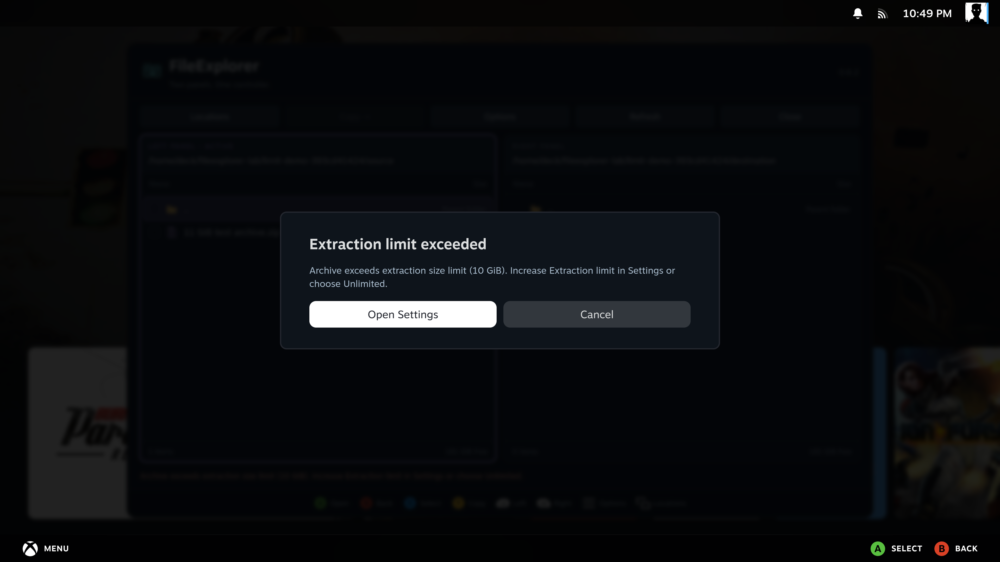

[Manual home](Home.md)

# Archives

FileExplorer can browse **ZIP, RAR, 7z and TAR**, including common compressed TAR
files, using SteamOS's libarchive. You can open archives stored locally or on a
direct SMB share. Plain GZ, BZ2 and XZ streams can also be opened; their
uncompressed payload is shown as a single file named `data`.

## Open an archive like a folder

1. Focus the archive and press **A**.
2. Open its folders with **A** and go up with **B** or **..**.
3. At the archive root, **B** returns to the folder containing the archive.

The panel marks the location **Archive • read-only**. Browsing does not modify the
archive. Rename, delete, editing and copying into an archive are unavailable.

| SteamOS PC | SteamOS handheld |
| --- | --- |
|  |  |

## Extract selected files or folders

1. Open a writable destination in the other panel. It can be local or SMB.
2. Return to the archive and select the desired entries with **X**.
3. Press **Y**, review the destination and confirm **Extract**.

A focused item is used when nothing is selected. A selected folder includes its
contents. Items appear by their selected names in the destination: selecting
`Profiles/Balanced.json` creates `Balanced.json`, while selecting `Profiles`
creates the `Profiles` folder with its contents.

The original archive remains unchanged. Extraction continues after closing the
window and uses the same [progress and notifications](Copy-and-Background-Jobs.md)
as copying.

## Extract the whole archive

Focus the archive in its containing folder, then choose
**Options → Extract whole archive to other panel**. This creates a new folder
named after the archive in a **local** destination. For example,
`Controller profiles.zip` becomes `Controller profiles`.

For a direct SMB destination, open the archive and extract selected entries
instead, or extract the whole archive locally and then copy the result.

## Space and format limits

- Selected extraction uses temporary local space before copying the selected
  contents to the destination. Remote archives are downloaded temporarily for
  reading, so allow local space as well as destination space.
- **Settings → Extraction limit** sets the maximum unpacked size per archive:
  10, 50, 100 or 500 GiB. Move the slider fully right for **Unlimited**.
  The default is 100 GiB. Unlimited removes the size cap, not the need for free
  destination and temporary disk space.
- Archives have a 100,000-entry limit. Unsafe paths, links and special files are
  rejected, including unsafe entries outside the selected subset.
- Password-protected and multipart archives are not supported. Some uncommon RAR
  methods may not be supported by the installed system library.
- To open an archive inside another archive, extract the inner archive first.
- Extract a text file before editing it. Archive contents are read-only.

An existing destination name stops extraction instead of overwriting it.
If the archive exceeds the size limit, a dialog shows the current limit and
offers **Open Settings**. This opens **Extraction limit** directly. Increase it
or choose **Unlimited**, then start extraction again. Opening Settings does not
change the limit or retry the operation automatically. **Cancel / B** returns to
the file manager.

| SteamOS PC | SteamOS handheld |
| --- | --- |
|  |  |

The bottom result message disappears after six seconds and does not return when
FileExplorer is reopened. Check the destination before retrying a failed
operation. See [Troubleshooting](Troubleshooting.md).
