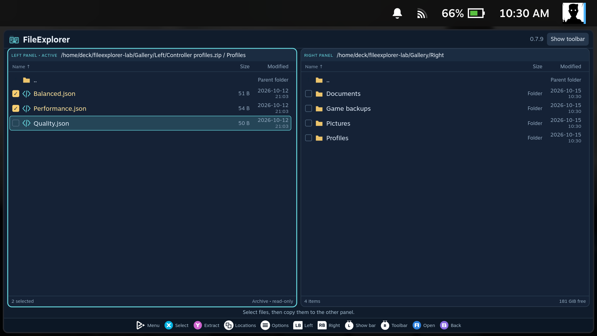
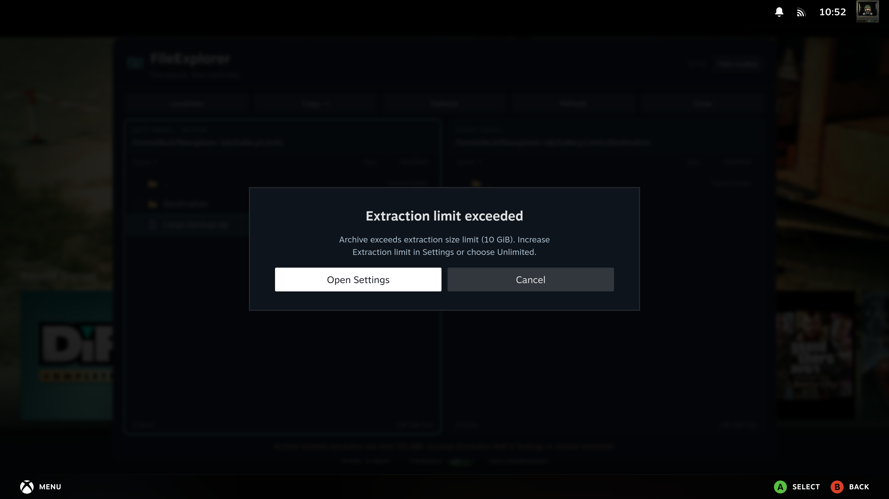
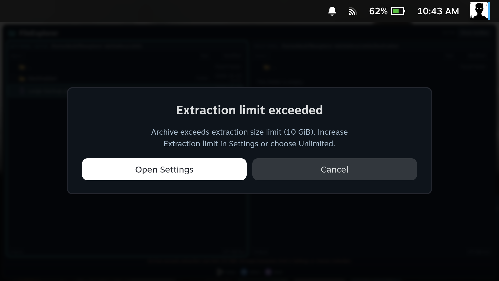

[Manual home](Home.md)

# Archives

## Create an archive

1. Select files or folders with **X**, or focus a single item.
2. Press **Menu / Start → Create archive…**. Mouse users can right-click the selection.
3. Enter a name and choose **ZIP, 7z, TAR, TAR.GZ, TAR.BZ2 or TAR.XZ**.
4. Choose the current or other panel as the destination and adjust compression.
5. Choose **Create archive**. The extension is added automatically if needed.

On a handheld, scroll through the fields with the controller. The Create/Cancel
buttons stay below the scrolling form. Adjust compression with left/right.

Compression level **0** stores ZIP/7z data without compression; **1** is fast and
**9** prioritizes size, with potentially higher memory use. Plain TAR has no
compression. Compressed TAR formats offer levels 1-9. The resulting size depends
on the files; already compressed media may shrink very little.

Local and SMB sources and destinations are supported. SMB output is first
created in temporary local storage, so that storage must have room for the
archive. Original files are kept. Existing archives are never overwritten.
Create the archive outside any selected folder. Links and special files are
rejected instead of being followed.

Packing continues after closing FileExplorer and reports background milestones.
Cancelling removes the unfinished local output; a disconnected SMB share can
retain a clearly named `.partial` file. Packing has no resume mode. RAR creation
and password-protected archive creation are not provided.

| SteamOS PC | SteamOS handheld |
| --- | --- |
|  |  |

## Browse existing archives

FileExplorer can browse **ZIP, RAR, 7z and TAR**, including common compressed TAR
files, using SteamOS's libarchive. You can open archives stored locally or on a
direct SMB share. Plain GZ, BZ2 and XZ streams can also be opened; their
uncompressed payload is shown as a single file named `data`.

## Open an archive like a folder

1. Focus the archive and press **A**.
2. Open its folders with **A** and go up with **B** or **..**.
3. At the archive root, **B** returns to the folder containing the archive.

The panel marks the location **Archive • read-only**. Browsing does not modify the
archive. Rename, delete, editing and copying into an archive are unavailable.

You can browse archives while a transfer is running. A remote archive may need
to download before its contents appear; **Reading archive** shows that the
request is in progress. Completing another transfer does not cancel that request.
Packing and extraction can also run alongside unrelated transfers or join the queue.

| SteamOS PC | SteamOS handheld |
| --- | --- |
|  |  |

## Extract selected files or folders

1. Open a writable destination in the other panel. It can be local or SMB.
2. Return to the archive and select the desired entries with **X**.
3. Press **Y**, review the destination and confirm **Extract**.

A focused item is used when nothing is selected. A selected folder includes its
contents. Items appear by their selected names in the destination: selecting
`Profiles/Balanced.json` creates `Balanced.json`, while selecting `Profiles`
creates the `Profiles` folder with its contents.

The original archive remains unchanged. Extraction continues after closing the
window and uses the same [progress and notifications](Copy-and-Background-Jobs.md)
as copying.

## Extract the whole archive

Focus the archive in its containing folder, then choose
**Options → Extract whole archive to other panel**. This creates a new folder
named after the archive in a **local** destination. For example,
`Controller profiles.zip` becomes `Controller profiles`.

For a direct SMB destination, open the archive and extract selected entries
instead, or extract the whole archive locally and then copy the result.

## Space and format limits

- Selected extraction uses temporary local space before copying the selected
  contents to the destination. Remote archives are downloaded temporarily for
  reading, so allow local space as well as destination space.
- **Settings → Extraction limit** sets the maximum unpacked size per archive:
  10, 50, 100 or 500 GiB. Move the slider fully right for **Unlimited**.
  The default is 100 GiB. Unlimited removes the size cap, not the need for free
  destination and temporary disk space.
- Archives have a 100,000-entry limit. Unsafe paths, links and special files are
  rejected, including unsafe entries outside the selected subset.
- Password-protected and multipart archives are not supported. Some uncommon RAR
  methods may not be supported by the installed system library.
- To open an archive inside another archive, extract the inner archive first.
- Extract a text file before editing it. Archive contents are read-only.

Whole-archive extraction requires an unused output name. Selected contents sent
through Copy use the [copy conflict choices](Copy-and-Background-Jobs.md#existing-files-cancellation-and-interrupted-copies).
If the archive exceeds the size limit, a dialog shows the current limit and
offers **Open Settings**. This opens **Extraction limit** directly. Increase it
or choose **Unlimited**, then start extraction again. Opening Settings does not
change the limit or retry the operation automatically. **Cancel / B** returns to
the file manager.

| SteamOS PC | SteamOS handheld |
| --- | --- |
|  |  |

The bottom result message disappears after six seconds and does not return when
FileExplorer is reopened. Check the destination before retrying a failed
operation. See [Troubleshooting](Troubleshooting.md).
