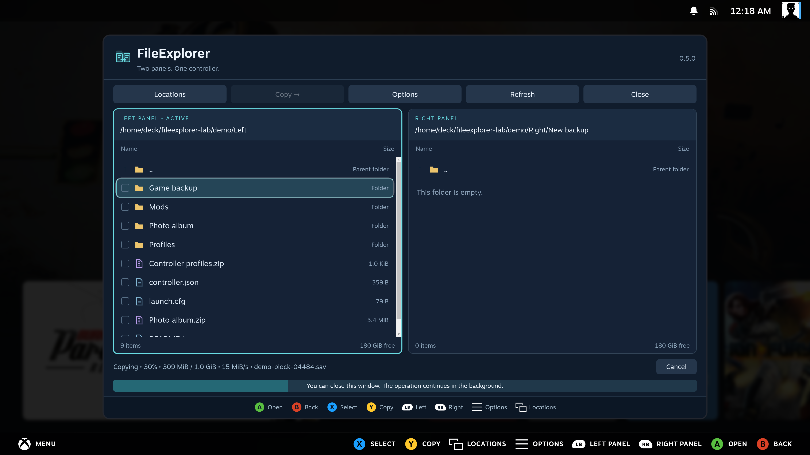
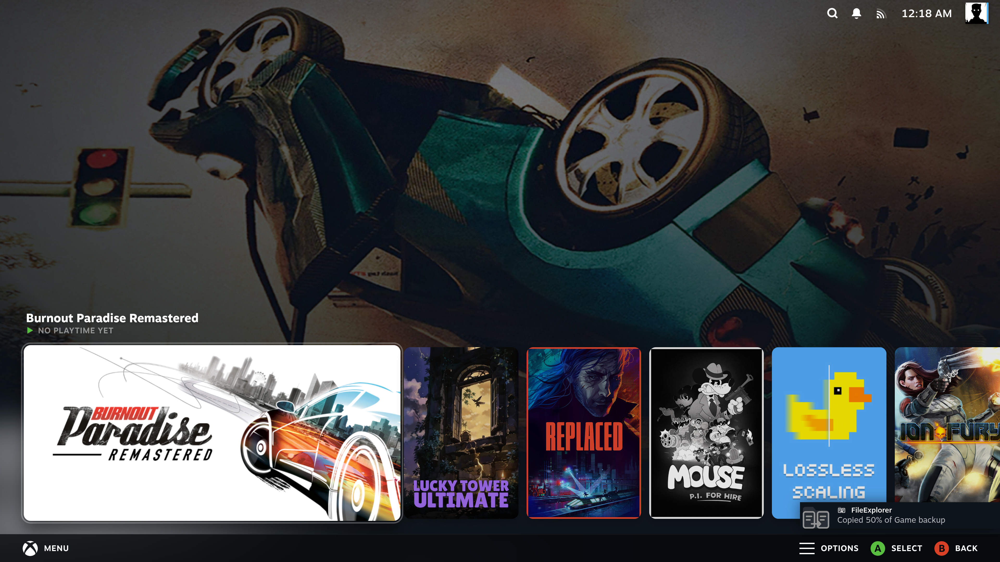
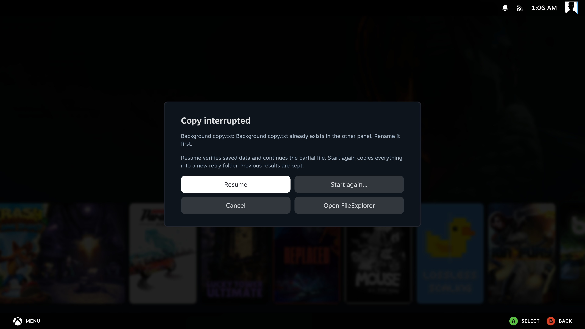
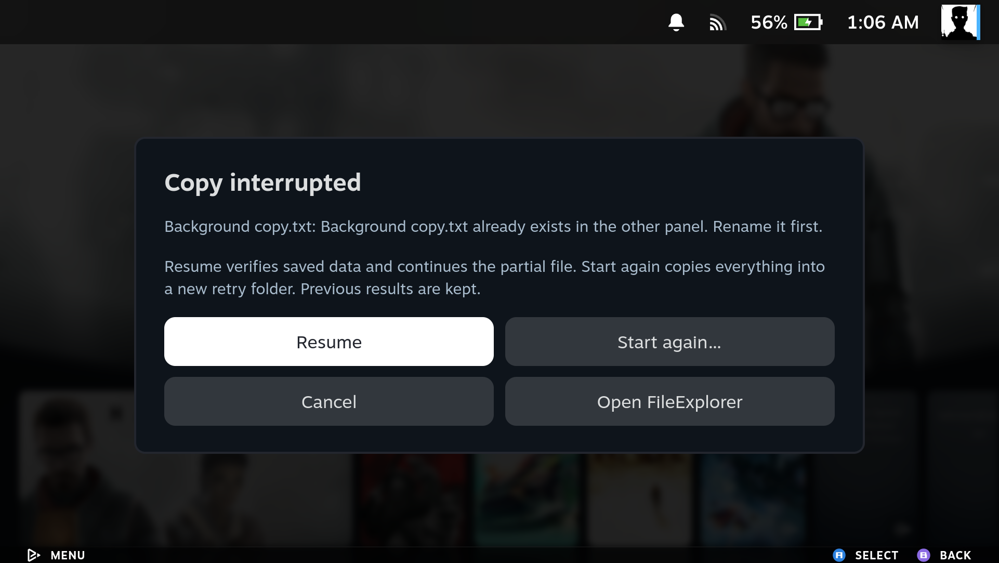

[Manual home](Home.md)

# Copying and background jobs

## Copy from one panel to the other

1. Open the source folder in one panel and the destination in the other.
2. Return to the source with **L1 / LB** or **R1 / RB**.
3. Select items with **X**, or focus one item to copy just that item.
4. Press **Y** or use **Copy** in the toolbar.
5. Check the displayed destination and confirm **Copy**.

Local-to-local, local-to-SMB, SMB-to-local and SMB-to-SMB copies are supported.
Copying a folder includes its contents. Only one background operation runs at a
time; this version has no job queue.

## Read the progress display

The bottom status shows the current phase, percentage, copied bytes and total,
live speed and current filename. Preparing a large directory or remote archive
can take time before byte progress begins.

Speed measures the work performed in the current operation, including temporary
staging where needed. Selected extraction has preparation
and destination-writing stages, so the overall percentage does not always equal
destination bytes divided by total bytes. The screenshot is a real transfer
reading, not a benchmark or promised speed.

## Close the window and carry on

Use **Close** to return to Steam. A separate systemd user service continues the
copy or extraction. Reopening FileExplorer reconnects to an operation that is
still running. Completed, cancelled and failed results stay in the bottom
status area for six seconds; reopening does not replay an old result.

While the window is closed, native notifications use the FileExplorer icon and
report **Copied / Extracted 25%, 50%, 75% and 100% • Done**. Failures and
cancellations are also reported. Steam and Decky must be running to display them.
When FileExplorer is open, progress stays in the window; milestones seen there
are not replayed as notifications after you close it.

These handheld captures show a real 4 GiB ZIP extraction continuing with the
panel closed. Long filenames may be shortened by Steam's notification layout.

A plugin reload does not stop the worker. **Shutdown, reboot or a stopped user
session interrupts the operation**. Interrupted operations do not resume automatically.

## Existing files, cancellation and interrupted copies

Existing names are not overwritten or merged. If a selected item already exists
in the destination, the operation stops with a message. Rename the source or
choose another destination before trying again.

Press **Cancel** in the progress area, then confirm **Cancel operation**. Dismissing the confirmation keeps the operation running. Wait for the final status before disconnecting a drive. Completed items and partial copy data are kept.

A failed copy offers **Resume**, **Start again…** and **Later**. After cancellation or reopening the window, use **Options → Resume interrupted copy…**. Reconnect a missing share first; session-only connections may need their login again.

If FileExplorer is closed when a copy fails, a popup offers **Resume**, **Start
again…**, **Cancel** and **Open FileExplorer**. This also applies to SMB copies.
**Cancel** dismisses the popup and keeps the partial copy. The popup appears once
per interrupted operation; recovery remains available from Options.

**Resume** verifies saved bytes against the source and continues the partial file, keeping completed files. It refuses changed source files or altered partial data. Checking a large saved prefix can take time. **Start again** asks for confirmation and copies all selected items into a new `FileExplorer retry …` folder in the original destination, keeping previous results.

Each top-level copy uses a hidden `.fileexplorer-*.partial` name until complete. Keep that item if you intend to resume. Only the latest interrupted copy is offered for recovery; starting another operation replaces that offer. Archive extraction does not support resume. Copies started by older plugin versions without checkpoints must be started again.

Copies preserve file contents and folder structure. They are not metadata
backups: ownership, permissions, ACLs and extended attributes are not reproduced.
Copying symbolic links and special files is refused.

See [Archives](Archives.md) for extraction and
[How it works](How-It-Works.md#background-job-lifecycle) for the worker lifecycle.

## Recovering a background copy

| SteamOS PC | SteamOS handheld |
| --- | --- |
|  |  |
