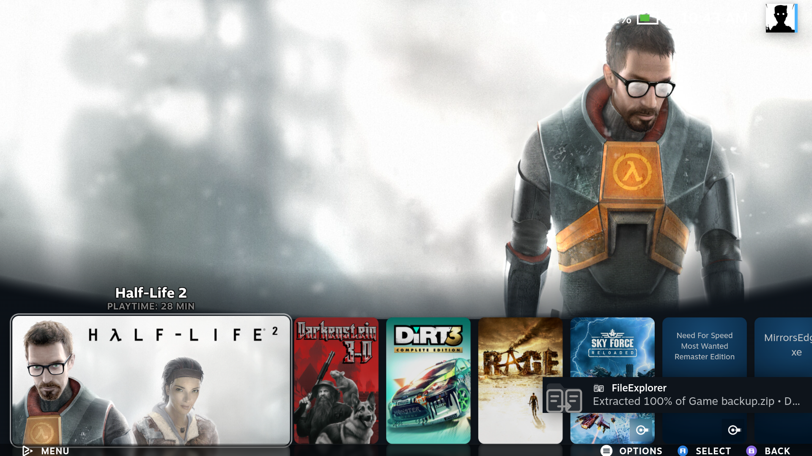
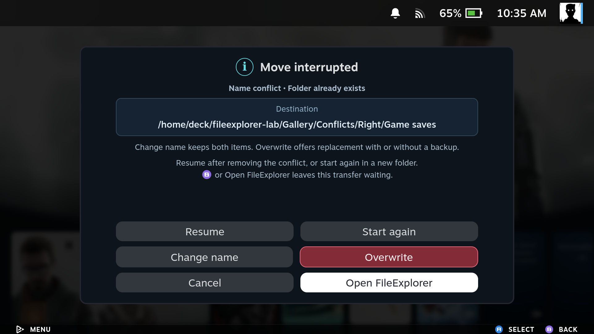

[Manual home](Home.md)

# Copying and background jobs

## Copy from one panel to the other

1. Open the source folder in one panel and the destination in the other.
2. Return to the source with **L1 / LB** or **R1 / RB**.
3. Select items with **X**, or focus one item to copy just that item.
4. Press **Y** or use **Copy** in the toolbar.
5. Check the displayed destination. For multiple selected items, choose **One at a time** or **In parallel**, with up to **5** simultaneous copies.
6. Confirm **Copy**. If transfers already exist, choose **Copy in parallel**, **Add to queue**, or **Cancel**.

Local-to-local, local-to-SMB, SMB-to-local and SMB-to-SMB copies are supported.
Each selected top-level file or folder becomes a separate task. Copying a folder
includes all its contents. At most **5 background operations** run across all batches combined;
extra tasks wait for a slot. **Add to queue** places a new batch after the tasks
already active or waiting. **Copy in parallel** lets it use a free slot alongside
the existing batch. The selected per-batch limit is also respected.

You can keep browsing, selecting other files, editing text and playing audio or
video during transfers. A completed copy refreshes the listings without clearing
other selections or taking focus from an open editor/player. Editing a file that
is itself being copied can make copy verification fail; finish that transfer first.

Use **Transfers** in the status area, or **Options → Transfers / queue**, to see
active and waiting tasks. Select one to inspect its progress or cancel it. Removing
a waiting task does not cancel another transfer. Moves, packing and extraction
can run beside copies or be added to the queue. Packing several selected items
creates one archive task.

Rename, New folder, Move to Trash and Empty Trash remain available during
transfers. An operation that conflicts with files used by an earlier transfer
waits for it; Rename and New folder report the conflict instead of changing
those paths. Paused transfers also reserve their files until resumed or cancelled.
Emptying Trash waits for operations that are adding files to Trash or using it.

## Queue controls on PC and handheld

| SteamOS PC | SteamOS handheld |
| --- | --- |
|  |  |
|  |  |
|  |  |

## Move to the other panel

Select items in the source panel, then choose **Menu / Start → Move to other panel**
and confirm the destination. With a mouse, use the file's right-click menu.

A move within the same filesystem or SMB connection uses a rename. Between
filesystems or shares, FileExplorer copies first and compares every copied file
with the source before removing source files. Existing destination items require
an explicit change-name, backup or overwrite choice. Moving archive members is unavailable; extract them instead.

If copying or verification fails, the source is kept. If cancellation or an error
occurs during source cleanup, completed moves stay in the destination and
remaining source files stay in place. New files appearing in a source folder
are never recursively removed. Check both panels before retrying. A move waiting
at a name conflict offers Resume to recheck the destination and Start again to
move the remaining items into a fresh folder. A stopped move cannot resume
partially copied data; that recovery is available only for checkpointed copies.

| SteamOS PC | SteamOS handheld |
| --- | --- |
|  |  |

## Read the progress display

The bottom status shows the current phase, percentage, copied bytes and total,
live speed and current filename. With parallel copies, the progress area splits
into up to five equal cards, one per active task. Select a card for its details
and cancellation controls. Preparing a large directory or remote archive can
take time before byte progress begins.

Speed measures the work performed in the current operation, including temporary
staging where needed. Selected extraction has preparation
and destination-writing stages, so the overall percentage does not always equal
destination bytes divided by total bytes. The screenshot is a real transfer
reading, not a benchmark or promised speed.
With hidden files enabled, the destination can also show FileExplorer's temporary
copy file. It is replaced by the final filename when that item completes.

## Close the window and carry on

Use **Close** to return to Steam. A separate systemd user service continues the
copy, move, packing or extraction. A separate queue service starts waiting tasks
without needing the window or plugin backend to stay open. Reopening FileExplorer
reconnects to the active and waiting tasks. Completed, cancelled and failed results stay in the bottom
status area for six seconds; reopening does not replay an old result.

While the window is closed, native notifications use the FileExplorer icon and
report **Copied / Moved / Packed / Extracted 25%, 50%, 75% and 100% • Done**. Failures and
cancellations are also reported. Steam and Decky must be running to display them.
When FileExplorer is open, progress stays in the window; milestones seen there
are not replayed as notifications after you close it.

These handheld captures show the four notifications from a real demonstration ZIP
extraction with the panel closed. Steam queues notifications, so a milestone can
remain visible after the operation has progressed further or finished. Long
filenames may be shortened by Steam's notification layout.

A plugin reload does not stop the worker. **Shutdown, reboot or a stopped user
session interrupts the operation**. Interrupted operations do not resume automatically.

## Existing files, cancellation and interrupted copies

Copy and move operations pause at a name conflict and show the destination in a
separate information card. Choose:

- **Resume** retries after you remove the conflicting destination. If it still exists, the dialog explains that you must choose another action.
- **Start again** starts the remaining items in a new `FileExplorer retry …` folder. Existing items and partial copies are kept.
- **Change name** gives the incoming item a different name and keeps the existing destination unchanged. A second collision asks again.
- **Overwrite**, shown in red, opens a confirmation. Choose **Back up & replace** to keep the existing item as `name.bak` (`.bak.2`, `.bak.3`, etc. if needed), or the red **Overwrite** action to permanently remove it after the replacement is ready.
- **Cancel** stops this task and keeps the existing destination item. Earlier completed items remain.
- **Open FileExplorer** opens the file manager and leaves the task waiting. **B** also dismisses the question without answering it. Use its progress card or **Options → Transfers / queue** to return.

| SteamOS PC | SteamOS handheld |
| --- | --- |
|  |  |
|  |  |
|  |  |

**Folders are replaced as whole items, not merged.** Overwrite also removes files
found only in the old destination folder. Choose the backup option to retain them.
The old item remains in place while a replacement copy is prepared. If the
destination changes during the wait, FileExplorer asks about the new conflict.

The question also appears while FileExplorer is closed. It is shown once per
conflict; dismissing it does not repeatedly reopen it. Only that copy waits;
independent parallel copies can continue. A sequential queue still waits for its
earlier task. Whole-archive extraction and new archive creation retain their
separate no-overwrite behavior.

Press **Cancel** in the progress area. A resumable copy offers three choices:

- **Keep for later** stops copying and preserves unfinished files and folders.
- **Remove partial files** stops copying and permanently removes this operation's unfinished copies. Completed top-level items already published in the destination stay, as do all source files.
- **Continue copying**, or **B**, closes the dialog without stopping the worker.

Wait for the final status before disconnecting a drive. Other operations, including moves, extraction and packing, use a separate cancellation confirmation and do not offer copy resume.

A failed copy uses the same six-button layout. **Change name** and **Overwrite** are available for name-conflict errors; other failures require fixing the underlying problem before Resume. After cancellation or reopening the window, use **Options → Interrupted copies** and choose the task. **Cancel** there offers keeping the partial copy or **Remove partial files…**, with a separate removal confirmation. Starting another operation does not remove earlier recovery tasks. Reconnect missing drives and make the SMB server reachable first.

If FileExplorer is closed when a copy fails, the same six-action popup appears.
This also applies to SMB copies.
**Cancel** dismisses the popup and keeps the partial copy. The popup appears once
per interrupted operation; recovery remains available from Options.

**Resume** verifies saved bytes against the source and continues the partial file, keeping completed files. It refuses changed source files or altered partial data. Checking a large saved prefix can take time. **Start again** asks for confirmation and copies all selected items into a new `FileExplorer retry …` folder in the original destination, keeping previous results.

Each top-level copy uses a hidden `.fileexplorer-*.partial` name until complete. Keep that item if you intend to resume. **Cancel → Remove partial files…** in the recovery window requires confirmation and removes only recorded staging items; it refuses unfamiliar files or links instead of deleting them recursively. If cleanup is interrupted, the task remains in Interrupted copies so removal can be retried.

## Shutdown or an empty battery

Copy checkpoints and job history are written to disk. After an unexpected shutdown, reopen FileExplorer and choose **Options → Interrupted copies → Resume**. The plugin detects that the old worker stopped and verifies retained data against the source before continuing. There is no automatic restart of file operations.

Tasks that had not started remain in **Transfers / queue** as paused. Reconnect
their drives or shares, then choose **Resume queue** when ready. Reloading Decky
within the same OS session does not pause or duplicate an existing queue.

Local copy writes, checkpoints and directory changes are flushed to storage. This reduces lost progress, but cannot guarantee recovery from faulty hardware or filesystem damage. For SMB, durability also depends on the server. Changed or damaged retained data is refused; **Start again** makes a separate copy without overwriting earlier results.

An unfinished SMB copy keeps an encrypted, device-bound login snapshot, including for a session-only connection, so it can resume after the backend restarts. Finishing or removing the copy deletes this snapshot. Forgetting a saved connection also removes its job snapshots. If a login is unavailable or its encryption key was lost, reconnect the share and start a new copy.

Archive extraction, moving and packing cannot resume partially written data after shutdown. Copies started by older plugin versions without checkpoints must also be started again.

Copies preserve file contents and folder structure. They are not metadata
backups: ownership, permissions, ACLs and extended attributes are not reproduced.
Copying symbolic links and special files is refused.

See [Archives](Archives.md) for extraction and
[How it works](How-It-Works.md#background-job-lifecycle) for the worker lifecycle.

## Recovering an interrupted copy

| SteamOS PC | SteamOS handheld |
| --- | --- |
|  |  |
