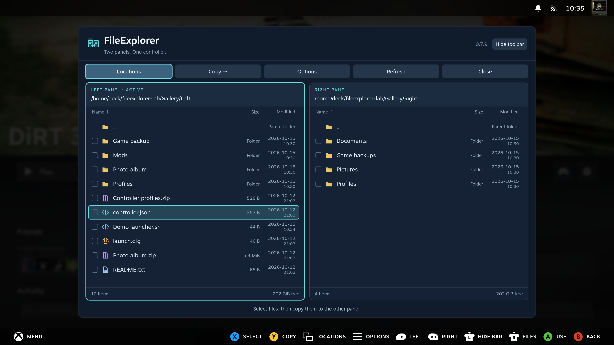
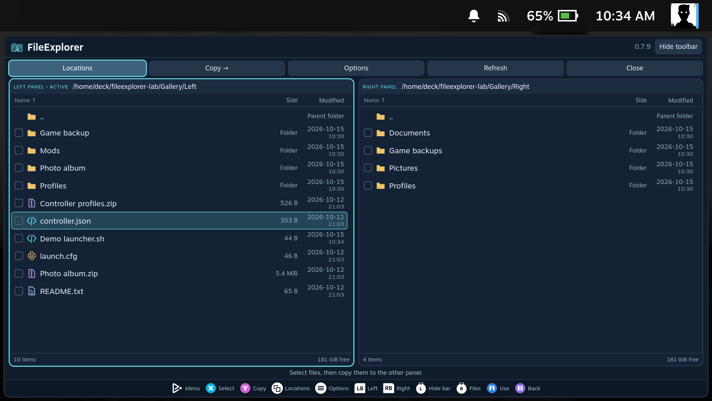
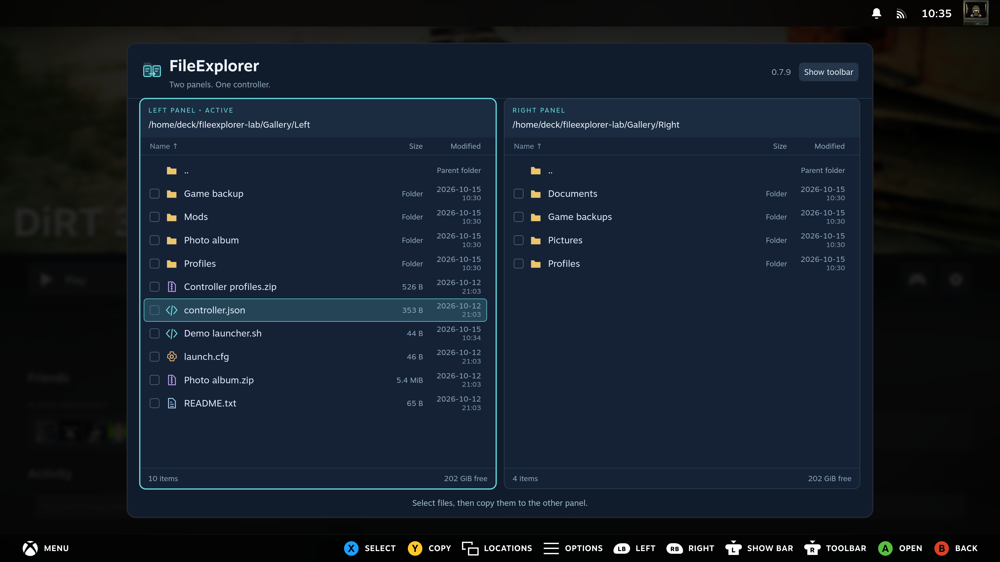
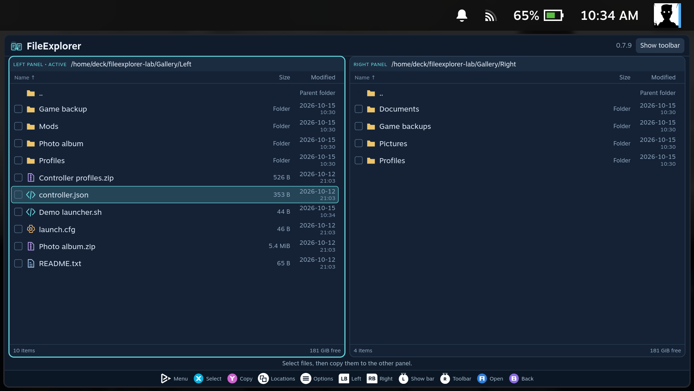
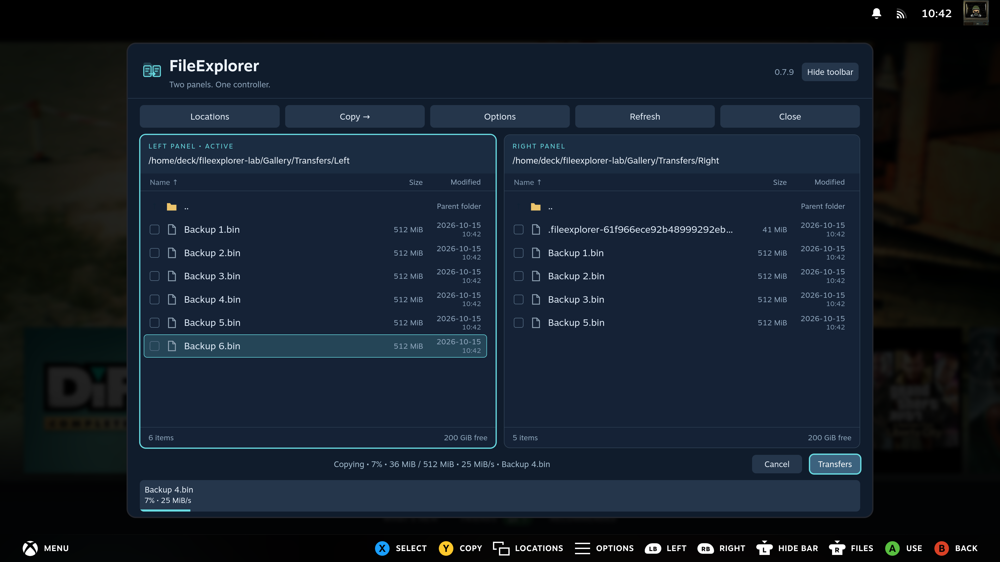
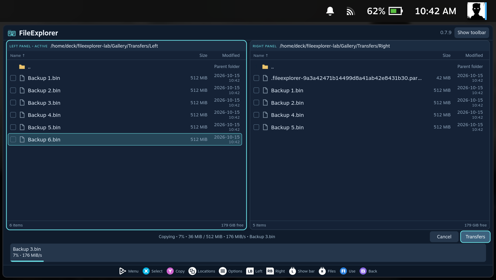

[Manual home](Home.md)

# Everyday use

## The two panels

The active panel is the source for file actions. The other panel is the destination
for copying or extraction. Both panels show their path, file list and selection
count; local folders also show free space.

On handhelds and smaller screens, FileExplorer fills the available space between
Steam's header and controller controls. Compact toolbars leave more room for files
while keeping your selected text size. Large displays retain the centered window.
The text editor, image viewer and media player adapt to the same available space.
The [handheld guide](Handheld-Guide.md) explains interface scaling, the keyboard
and where to show the controller hints.

| SteamOS PC | SteamOS handheld |
| --- | --- |
|  |  |

Open a folder with **A**. The **..** row and **B** go to its parent. At the
filesystem or share root, **B** closes FileExplorer. The toolbar's **Close** button
closes the window immediately, without cancelling a background transfer.

**Locations** changes the active panel. It includes Home, Downloads where present,
mounted drives and remembered SMB connections. **Enter path** accepts an absolute
local path, such as `/home/deck/Downloads`; use **Add SMB share** for a new SMB
connection.

## Dates and sorting

The **Modified** column shows the last modification date of each file and folder,
with `YYYY-MM-DD` above the time in `HH:mm` format. Times follow the device's local
timezone. Local disks, SMB shares and entries inside archives use the same columns.
When an archive does not store a date, FileExplorer shows **-**.

Open **Options → Sort by…** and choose **Name (A-Z)**, **Size (largest first)**
or **Date modified (newest first)**. The arrow in the column heading marks the
active order. The change applies immediately to both panels, retains selected
items and is remembered for the next launch. **Folders first** still follows
your Settings choice; when enabled, dates sort folders and files within their
own groups. The same choice is available in **Settings → Sort by**.

Press **B** to cancel the sort chooser and return to Options.

## Scrolling long folders

Each panel has its own dark scrollbar with a rounded thumb. The thumb uses your
accent color on hover or drag. Controller navigation keeps the focused row visible;
mouse users can drag the thumb to move through a long list.

See in action: scrolling on PC and handheld

| SteamOS PC | SteamOS handheld at 70% scale |
| --- | --- |
|  |  |

## Controller reference

These names use Xbox / Steam Deck conventions. The on-screen legend uses Steam's
glyphs for the controller you are using.

| Button | In the file manager |
| --- | --- |
| D-pad / left stick up and down | Move through file rows and vertical menus |
| D-pad / left stick left and right | Switch file panels or move between controls placed side by side |
| L1 / LB | Focus the left panel |
| R1 / RB | Focus the right panel |
| R3 | Cycle through toolbar, active transfer controls and the current file row |
| L3 | Hide or show the top toolbar |
| A | Open a supported folder, archive, text file, image, audio or video; confirm a control |
| B | Go back to the parent folder or dismiss a dialog |
| X | Select or deselect the focused item, then move to the next file or folder |
| Y | Copy to the other panel; extract when browsing an archive |
| Start / Menu | Open file and folder options |
| View / Select | Open Locations |

Use **Left/Right** to move between the two file panels. During a transfer,
press **Right from the right panel** to reach Cancel/Transfers directly,
or **Left from the left panel** to reach the last transfer action.
Left/Right then moves between those buttons; continuing past the end returns
to the file panels. Up returns to the remembered file row; Down reaches the
progress cards. This also works with the toolbar hidden. Without a transfer,
Left/Right wraps between the panels.

R3 reaches the toolbar from any file row, revealing it if hidden. During a
transfer, the next R3 reaches **Cancel / Transfers** above the progress cards;
another returns to the remembered file row. Without a transfer, the second R3
returns directly to the files. Down from the toolbar also returns to the files.
L3 hides only the top toolbar and remembers the choice; the controller legend
keeps its Settings choice.
The header also has a Hide/Show toolbar button for mouse and touch.

Menu navigation wraps at the ends: Up from the first enabled item reaches the
last, and Down from the last reaches the first. Each Options column wraps
independently. Menu button rows wrap left/right. The transfer controls connect back to the file panels. Disabled actions are
skipped. File lists wrap too; after X on the last file, selection moves to the
first file, skipping the parent-folder row. Text entry and slider adjustment keep
their usual directional controls.

See in action: R3 and L3 on PC and handheld

| SteamOS PC | SteamOS handheld |
| --- | --- |
|  |  |
|  |  |

The [text editor](Text-Editor.md) has its own legend: **A** edits a line,
**X** inserts one, **Y** saves the file and **R3** switches between text and toolbar.
The [image viewer](Image-Viewer.md) uses **left/right** or **L1/R1** to change
pictures in the current folder, and **B** to return to the file list.

The [media player](Media-Player.md) uses **A** for play/pause, **left/right** to seek, **L1/R1** for previous/next file, **X** to stop and **Y** for fullscreen video. **R3** switches to the toolbar.

Files have distinct icons for folders, archives, pictures, audio, video, configuration, code and other text. Unsupported types have no A action. Use **Options → Edit file** for an unfamiliar text extension; binary files are still rejected.

## Select files

Press **X** on each desired item. A check mark and the selection count show what is
selected. If nothing is selected, a copy uses the focused item. Opening another
folder clears that panel's selection.

**Options → Select all** selects the visible entries. When a selection is present,
the same menu offers **Clear selection**. Hidden entries are not listed unless
**Show hidden files** is enabled; copying a selected folder still includes its
contents, including hidden files.

For mouse control, click a row to focus it, double-click to open it and click its
selection square to toggle it. Right-click a row to open its Options menu. A
right-click on a selected row keeps the current multi-selection; on another row,
it targets only that item. Use **Refresh** after changes made by another app.

## Reach transfer controls

During a transfer, press **R3** once for the toolbar and again for **Cancel / Transfers**.
Use **A** to open the selected action. Press R3 again to return to the remembered file row.

| SteamOS PC | SteamOS handheld |
| --- | --- |
|  |  |

## File and folder options

Options has two columns. **Selected file / folder** contains copy, move, rename,
packing, extraction, editing and Trash actions. **Current folder / FileExplorer**
contains New folder, selection controls, Locations, transfers, Empty Trash,
Refresh and Close. Use **left/right** between columns and **up/down** within them.
Unavailable actions stay disabled. Long menus scroll inside their own column on
smaller screens.

**B** or **Cancel** from Rename, New folder, Locations, Empty Trash and the other
Options dialogs returns to Options with the previous button focused. Press B
again to return to the file panels. Inside Locations, B from **Add SMB share** or
**Enter path** returns to Locations first. Confirming a file operation or choosing
a location returns to the file panels.

| SteamOS PC | SteamOS handheld |
| --- | --- |
|  |  |

| Option | What it does |
| --- | --- |
| Copy to other panel | Opens a confirmation with the destination path |
| Move to other panel | Moves selected items; verifies cross-filesystem data before source removal |
| Create archive | Choose name, format, compression and destination panel |
| Add to Steam | Adds a local executable or script as a non-Steam shortcut |
| Extract whole archive | Creates a new folder in a local destination |
| Rename | Renames one item; enter a name without path separators |
| Edit file | Tries opening a regular file as text, including unfamiliar extensions |
| Move to Trash | Moves local items to the SteamOS Trash |
| Delete permanently | Deletes items on a direct SMB connection after confirmation |
| New folder | Creates a folder in the active panel |
| Locations / network shares | Opens the location chooser |
| Empty Trash | Opens the separate warning for the shared Desktop Mode Trash |

Unavailable actions are disabled, for example renaming an archive member or
starting a move while another operation is running. Additional copies can be
queued or run in parallel; browsing, text editing and media remain available.

Next: [Copying and background jobs](Copy-and-Background-Jobs.md).
