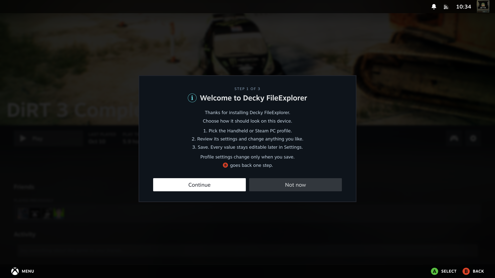
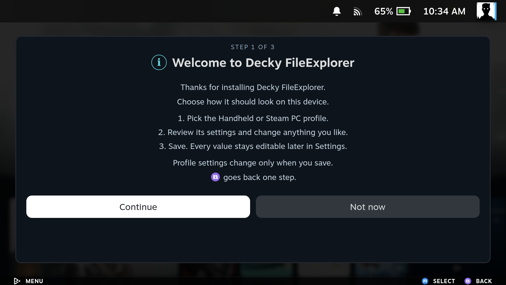

[Manual home](Home.md)

# First setup

The first **Launch FileExplorer** shows a centered startup image for three
seconds, then opens a three-step setup:

1. **Welcome.** Read the introduction and select Continue.
2. **Choose a profile.** Handheld leaves more room for files with smaller controls
   and a hidden toolbar. Steam PC uses larger controls and keeps the toolbar visible.
3. **Review and save.** Change any of the proposed settings, then select Save to
   open the file manager.

Profile settings change only after **Save**. The controller Back button goes back one step; from the welcome page,
it closes setup. If you close it without saving, it appears on the next launch.
The on-screen hint uses the current controller's glyph supplied by Steam.
An existing installation keeps its settings and remembered network connections
until you choose to save a profile.

On a handheld or a small screen, setup fills the available space between Steam's
header and footer. On a PC it stays centered. The settings list scrolls while
**Save** and **Back** remain visible at the bottom.

The amber note on step 3 confirms which recommended profile is selected.
Focus any setting and press **X** (the Help glyph shown by Steam) for its
explanation. Press X again to hide it; moving up/down closes the help too.
Descriptions use the same help as the regular Settings panel.

### Startup image

**Splash screen** is **Off** by default in both profiles and in Settings.
The image appears once on the first launch, including the first launch after
upgrading from a version without this feature. Cancelling setup or restarting
SteamOS does not replay it. Turn Splash screen On to see it for three seconds
on every launch, or Off to skip it again. Reopening setup does not reset the
one-time display.

## Profile defaults

| Setting | Handheld | Steam PC |
| --- | --- | --- |
| Panel opacity | 100% | 100% |
| Interface scale | 70% | 100% |
| Text size | Default | Default |
| Controller legend | FileExplorer panel only | Steam bar only |
| Toolbar | Hidden | Visible |
| Splash screen after the first launch | Off | Off |
| Show hidden files | On | On |
| Folders first | On | On |
| Remember folders | On | On |
| Startup update check | On | On |
| Sort by | Name | Name |

These are starting points. Every setting remains editable in **Settings**.
Use **Settings → Run first-time setup** to choose a profile again. The existing
accent color is retained unless you change it during setup.

**L3** hides or shows the file manager's toolbar and remembers that choice.
**R3** can reveal it temporarily to reach its buttons. During a transfer, R3
also reaches Cancel and Transfers before returning to the file list.

## Setup on PC and handheld

| SteamOS PC | SteamOS handheld |
| --- | --- |
|  |  |
|  |  |
|  |  |
|  |  |
|  |  |
