[Manual home](Home.md) · [Handheld guide](Handheld-Guide.md) · [PC gallery](../SCREENSHOTS.md)

# FileExplorer on a handheld

These screenshots show the installed plugin on a **ROG Ally running
SteamOS**, captured on 15 October 2026. Steam supplies the controller glyphs.
The files and pictures are demonstration content; network discovery shows the
real local test network. Individual images are native handheld captures; the
labelled legend comparison retains four earlier captures arranged into a grid.

The window fills the available space below Steam's system header. The Handheld
profile uses **70% interface scale**, default text size, an opaque panel, a hidden
file toolbar and controller hints only inside FileExplorer. The labelled scaling
examples use 80%; toolbar demonstrations temporarily reveal the bar.

## First setup

Choose a profile and review its settings. The handheld wizard fills the available
space; its settings scroll above fixed Save and Back buttons.

The centered splash appears once for three seconds; repeat displays are off by default.

Press the controller Help button on any setup setting for its explanation.

## Long file lists

The dark, rounded scrollbar matches the file panels. Controller navigation keeps
the focused file visible; the other panel can stay at its own position.

[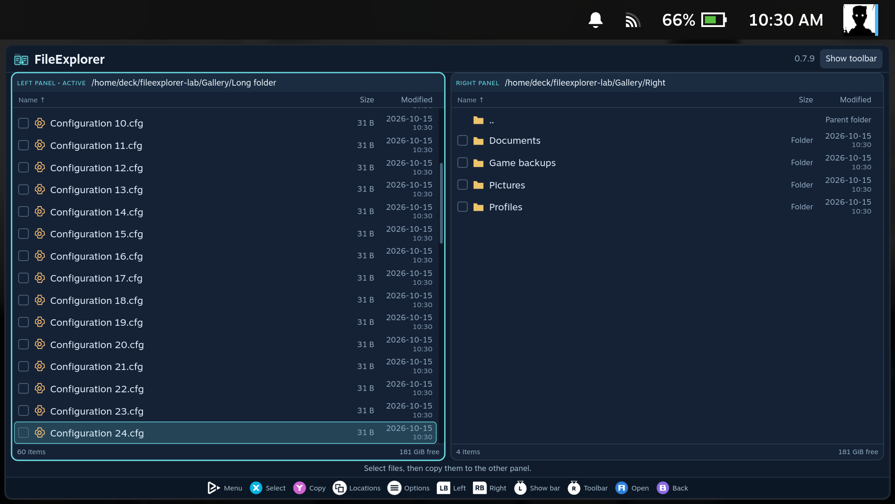](../../images/screenshots/handheld-scrollbar-3ff58663210a.png)

## Two panels and archives

Select with **X**, switch panels with **L1/R1**, and copy with **Y**.

The **Modified** column shows local date and time for files and folders.
**Options → Sort by…** changes the order of both panels immediately.

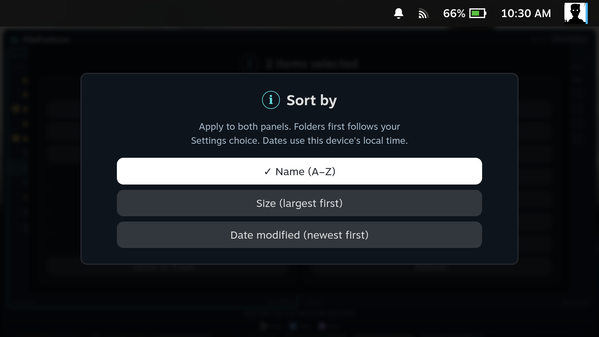

Open an archive with **A**, select individual items, and use **Y** to extract
them into the other panel.

## Text editing with the controller

Press **R3** to reach the toolbar; use left/right to choose an action. Press
R3 again to return to your cursor. **Menu/Start** performs Undo directly.

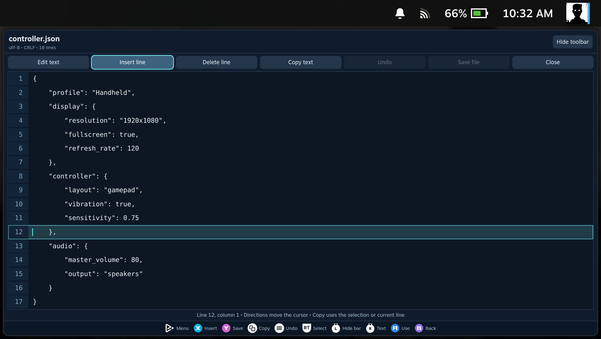

Press **A** in the text to open Steam's keyboard. The whole editor moves above
it and keeps the current line visible.

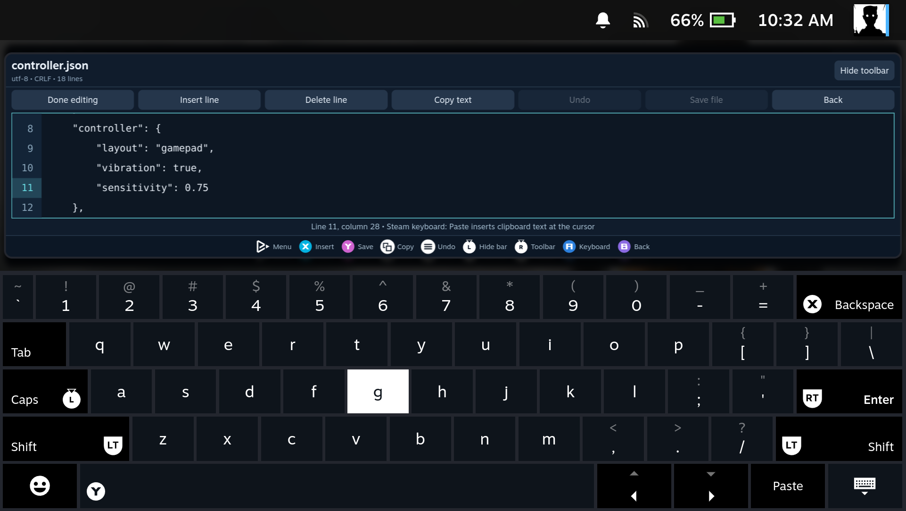

Press **L3** to hide the toolbar and gain more text space. L3 works while the
keyboard is open. Press it again to show the toolbar; R3 also reveals it.

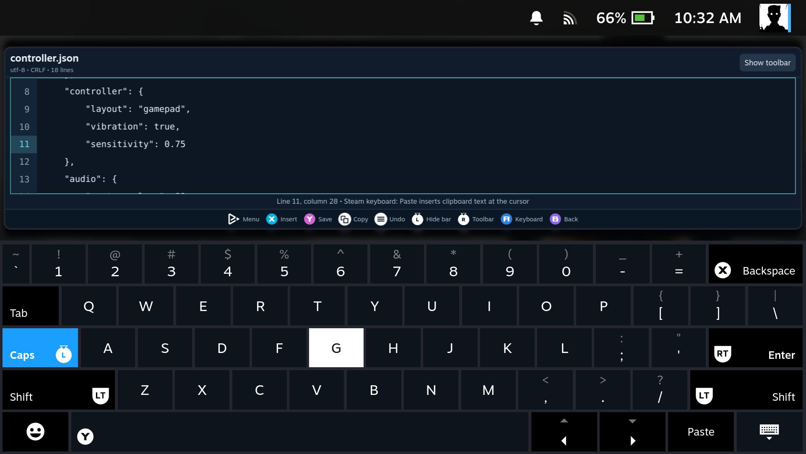

With the keyboard hidden, hold **RT + directions** to select text, then use
**View/Select** to copy. Steam's keyboard provides Paste.

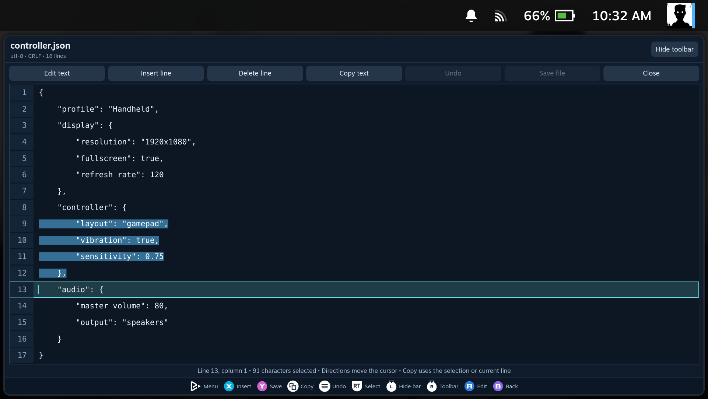

## Smaller controls in the same window

Open **Decky → FileExplorer → Settings → Interface scale**. Choose 90%, 80% or
70%, then reopen FileExplorer. The Handheld profile starts at 70%; Steam PC starts
at 100%. The setting scales the file
manager, editor, image viewer and media player together. Text size can be adjusted separately.

These examples use **80% interface scale** and the default text size. The window
still fills the same space, leaving more room for files and text.

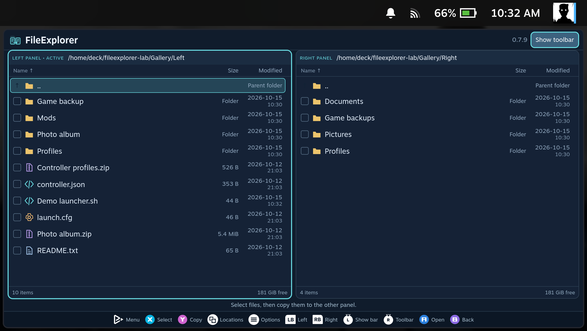

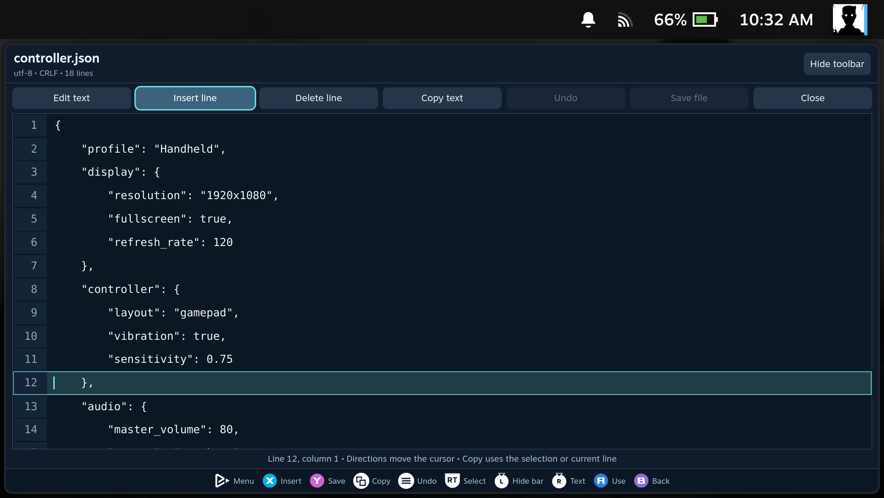

## Pictures, including images inside archives

Press **A** on an image. **Left/right** or **L1/R1** changes the picture within
the current folder; **B** closes the viewer. The generated demonstration
illustrations below are displayed by the real image viewer.

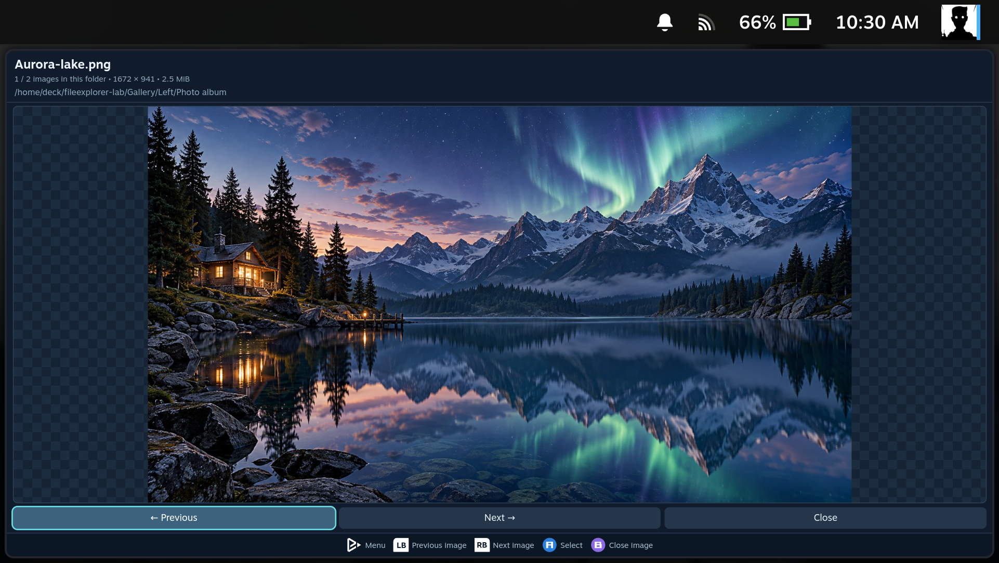

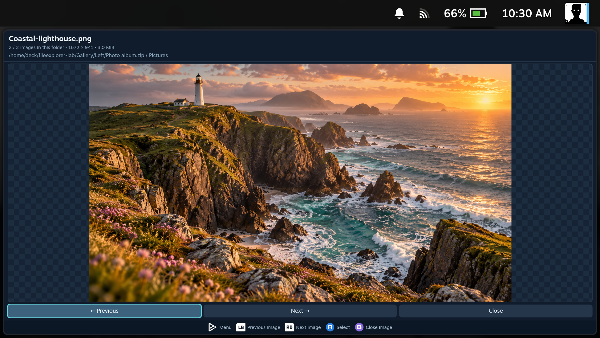

## File actions and Trash

Use **Menu/Start** to open Options for the current file.

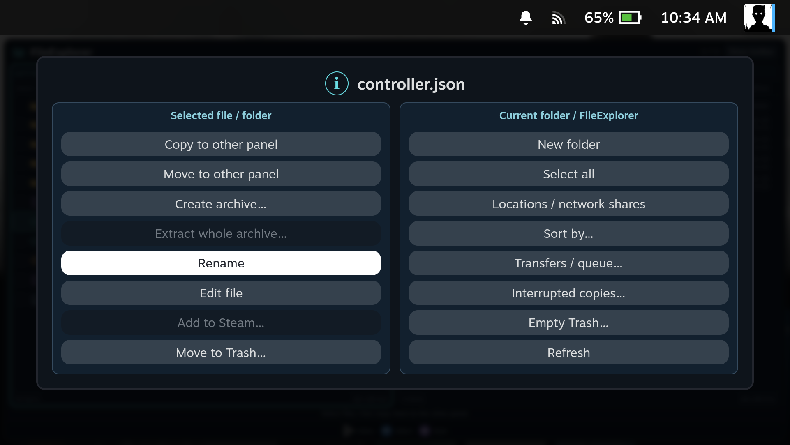

**Empty Trash** warns that Desktop Mode uses the same Trash. This dialog was
cancelled for the screenshot; no user files were deleted.

## Network shares and preferences

Choose **Locations → Add SMB share → Find servers** to discover local servers.
Choose a server, then use **List shares** and enter credentials if needed.

Appearance options and the optional startup update check stay in Decky's sidebar.
Opacity, interface scale and extraction limit use sliders. Press **X** for a
setting's explanation; **up/down** closes it and continues through the list.

The rightmost extraction-limit position is **Unlimited**. This removes the size
cap while retaining archive path and link checks.

## Archive limits and background extraction

An archive exceeding the selected size cap shows the current limit and an
**Open Settings** button that takes you directly to **Extraction limit**.

Copying and extraction continue after closing FileExplorer. See the
[four background extraction notifications](Copy-and-Background-Jobs.md#close-the-window-and-carry-on)
captured during a real background extraction on this handheld.

## Media, recovery and controller hints

[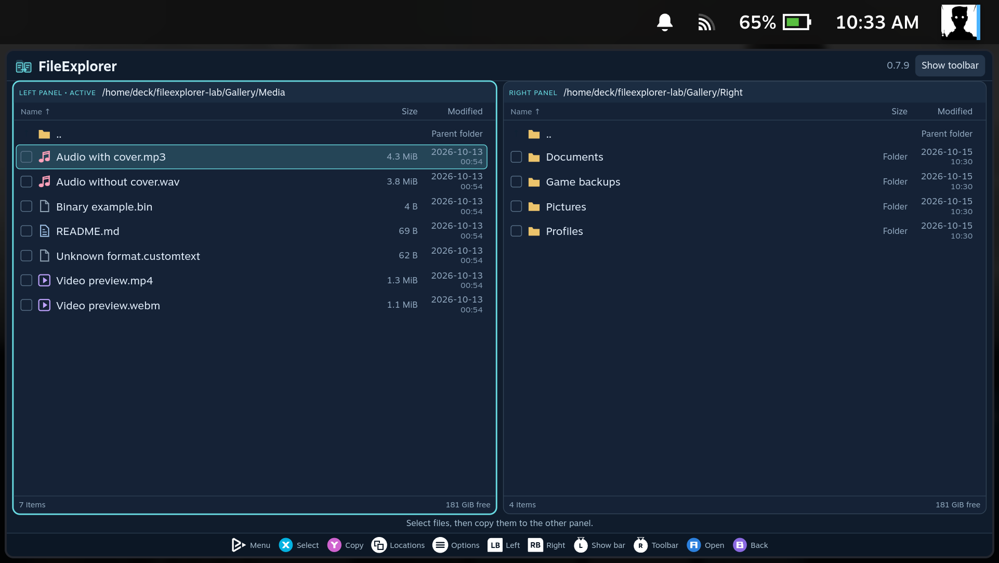](../../images/screenshots/handheld-media-file-icons-8ffe0ce5207f.png)

## Compare controller legends

Panel only, Steam bar only, both and hidden. Four native captures arranged side by side.

## Moving, packing and Steam integration

## Copy queue and parallel progress

Each task has its own progress. Choose up to five copies, or queue the selection after existing tasks.

## Recover unsaved text

Restore a saved draft after interruption, keeping the original file unchanged until Save.

## Name conflicts and grouped Options

File actions and folder controls occupy separate columns. Copy and move conflicts use six actions, with a separate backup or overwrite confirmation.

