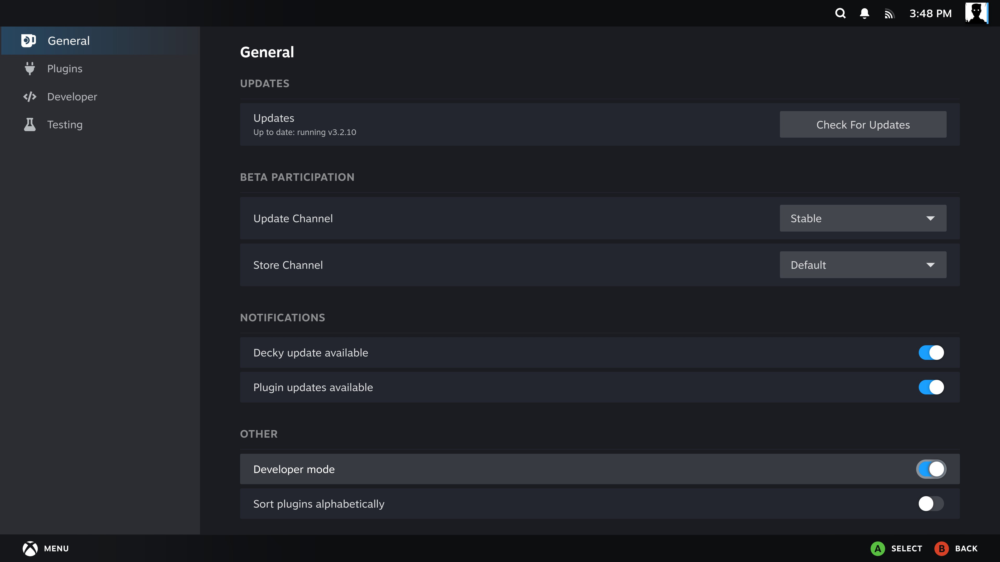
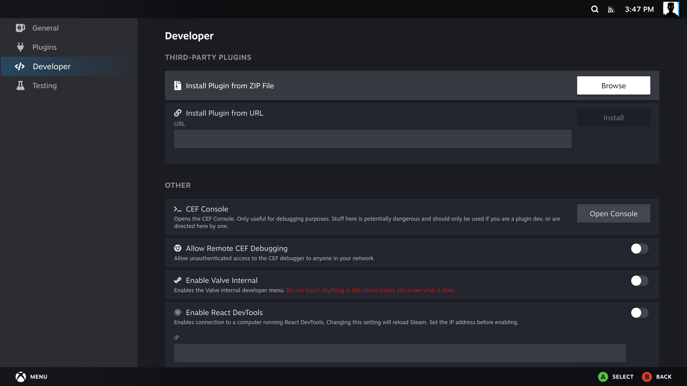

[Manual home](Home.md)

# Installation and updates

You need a SteamOS system with a working
[Decky Loader](https://github.com/SteamDeckHomebrew/decky-loader) installation.
FileExplorer runs as your Steam user and uses the system's Python, systemd user
services and libarchive. Its Python package dependencies are included in the ZIP.

FileExplorer was tested on **SteamOS 3.8.28 / Decky Loader 3.2.10 on an x86-64 PC**.
It has no kernel module or exact-kernel bundle requirement. Other SteamOS releases
and physical controllers have not all been individually tested.

## Download the plugin ZIP

1. Download the **FileExplorer plugin ZIP** from the
   [latest release](https://github.com/60plus/Decky-FileExplorer/releases/latest).
2. Save it somewhere accessible on the SteamOS machine, such as **Downloads**.
   Keep it as a ZIP. The automatically generated source-code archives are not
   installable plugin packages.

If you downloaded on another computer, copy the ZIP to SteamOS first.

## Enable Decky's Developer mode

In Gaming Mode, open the quick-access menu, select **Decky** and open its
**settings**. In **General**, scroll to **Other** and enable **Developer mode**.
This is Decky Loader's setting.

## Install from a ZIP or a link

Open **Developer** in Decky's settings sidebar.

### Option A: downloaded ZIP

1. Under **Install Plugin from ZIP File**, select **Browse**.
2. Select the downloaded **FileExplorer** plugin ZIP.
3. Accept Decky's installation prompt and wait for installation to finish.

### Option B: direct download link

1. Copy the direct download link for the **FileExplorer plugin ZIP** attached to
   the release. Do not use the release page, repository address or source archive.
2. Paste it into **Install Plugin from URL** and select **Install**.
3. Accept Decky's installation prompt.

The public release download links work directly in Decky without a GitHub login.

Return to Decky, open **FileExplorer**, then choose **Launch FileExplorer**.
The two Decky settings screenshots are reused from the
[DeckyCache installation guide](https://github.com/60plus/DeckyCache/wiki/Installation).

## First launch

Both panels start in your home folder unless remembered locations are available.
Use **Locations** to choose Home, Downloads, a mounted drive or a network share.
Each panel has its own location. Follow [Everyday use](Daily-Use.md) for the controls.

## Update an existing installation

1. Open **FileExplorer → Update → Check for updates**.
2. Read the available version and release notes, then select **Download and install**.
3. Wait for download verification, then confirm **Install** in Decky's prompt.
4. Reopen FileExplorer's Update or About page to check the installed version.

FileExplorer checks GitHub when Decky starts and reports a newer stable release
at most once per OS boot. Reloading Steam or the plugin does not repeat the notice.
Turn off **Settings → Check for updates at startup** to disable automatic checks
and notifications. Manual checks remain available. An offline startup retries
quietly every five minutes until a check succeeds; installation always requires your action.

You can also download the plugin ZIP from the [latest release](https://github.com/60plus/Decky-FileExplorer/releases/latest)
and install it through Decky's Developer settings.

Settings and remembered connections are stored separately from the plugin files.
An already running copy or extraction has its own worker files and can continue
through a plugin reload or replacement. Notifications become available again
when Steam and Decky are running. A system reboot still interrupts the operation.

## Remove the plugin

Finish or cancel the current operation and wait for its final status. Then use
Decky's plugin management to uninstall FileExplorer. Removing the plugin is not
the control for cancelling a transfer; use **Cancel** in the open file manager.

If you want to remove saved SMB login details first, use
**FileExplorer → Settings → Saved connections → Forget** for each connection.
Files you copied to other folders are ordinary files and are not removed by
uninstalling the plugin.
