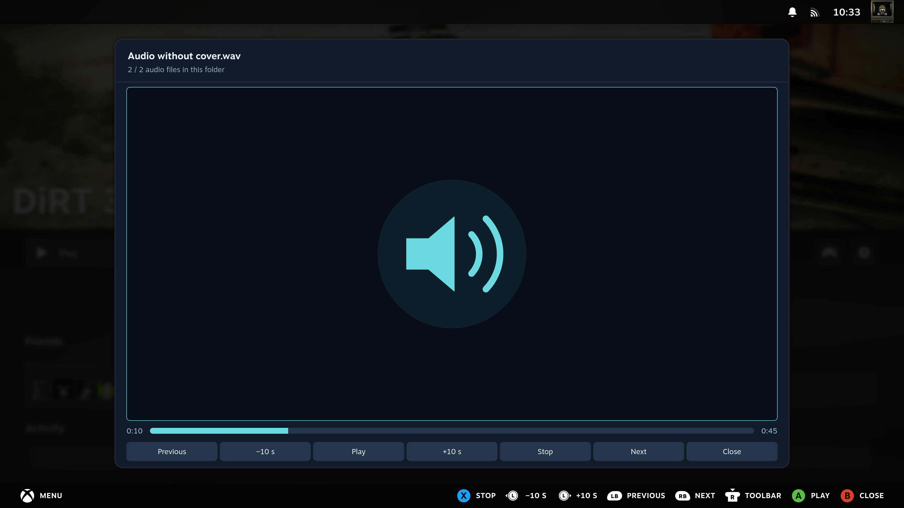
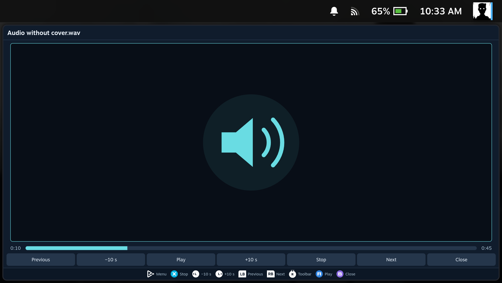
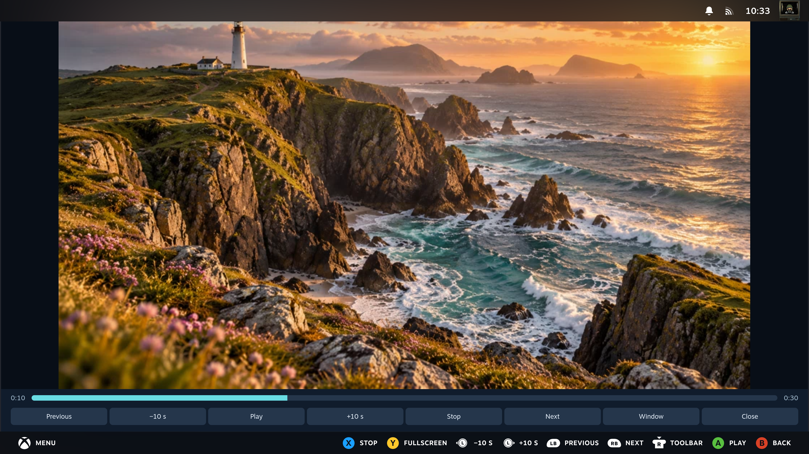
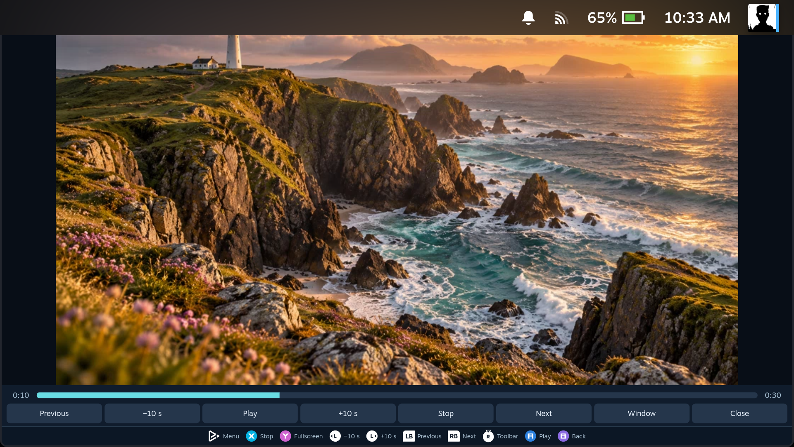

[Manual home](Home.md)

# Audio and video

Press **A** on an audio or video file to open the player. Local folders and direct
SMB shares are supported. Extract media from an archive before playing it.
Closing the player stops playback.

## Controls

| Button | Action |
| --- | --- |
| A on the picture or cover | Play / pause |
| Left / right on the picture or cover | Seek backward / forward 10 seconds |
| L1 / R1 | Previous / next audio file or video in this folder |
| X | Stop and return to the beginning |
| Y for video | Enter / leave fullscreen |
| R3 | Switch between playback and toolbar controls |
| B | Leave fullscreen, or close the player |

The toolbar provides the same actions. On the toolbar, directions navigate its
buttons. A mouse can also click the progress bar to seek. Audio and video use
separate playlists in the folder's displayed order.

Audio shows its embedded cover when available, with a speaker icon otherwise.
The player does not search online for artwork.

## Formats and compatibility

- Audio: MP3/MP2, WAV, FLAC, Ogg/Vorbis, Opus, M4A/M4B, AAC and WebM audio.
- Video: MP4/M4V, MOV, WebM, OGV and MKV.

The actual codecs inside a file matter as well as its extension. Steam plays
supported codecs directly. When decoding fails, FileExplorer can use the system's
**FFmpeg** for compatibility playback without changing the original file. Video
is converted while playing, up to **720p and 30 fps**; this uses CPU time and
seeking may briefly buffer. If FFmpeg or the required decoder is unavailable,
the player shows an error and still lets you move to the next file.

The window fits handhelds and uses the selected interface scale. Choose
**Settings → Controller legend** for hints on the panel, Steam bar, both or neither.

## In Gaming Mode

| SteamOS PC | SteamOS handheld |
| --- | --- |
|  |  |
|  |  |
|  |  |
|  |  |
