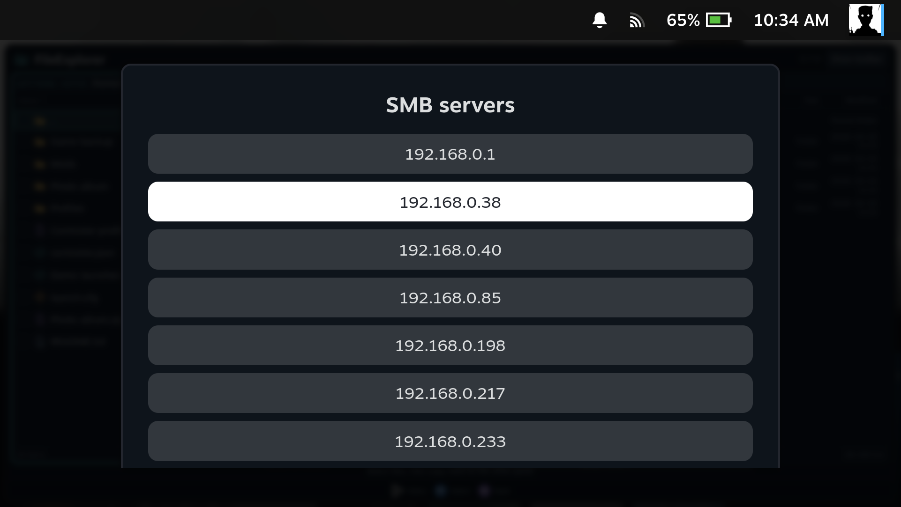
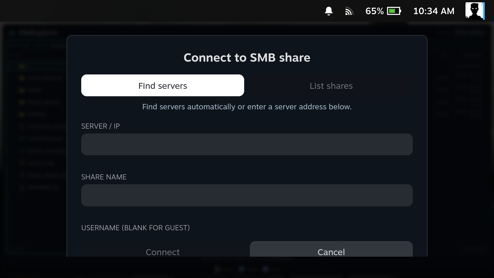

[Manual home](Home.md)

# Network shares

Connect directly to SMB shares on a NAS or another computer, or browse network
shares already mounted by SteamOS. Either panel can point to a network location.

## Find an SMB server automatically

1. Select the panel where the share should open.
2. Open **Locations → Add SMB share**.
3. Choose **Find servers** and wait for the results.
4. Select a server to fill **Server / IP** in the connection form.

| SteamOS PC | SteamOS handheld |
| --- | --- |
|  |  |

This screenshot shows seven real results from the test LAN. Names appear when
the service advertises them; otherwise the list shows the local IP address.
Finding a server does not automatically log in or guarantee access to its shares.

Discovery combines advertised SMB services with a TCP 445 check on directly
connected private IPv4 networks. It checks up to 512 addresses; on networks
larger than /24 it restricts the route scan to the computer's local /24.
Other subnets, VPN routes and servers hidden by a firewall may require manual entry.
No login details are sent by the discovery scan.

## Choose a share and connect

1. If the server needs authentication, enter **Username**, **Password** and, if
   required, **Domain** before choosing **List shares**.
2. Select a share from the list, or type its exact name in **Share name**.
3. Optionally set a **Display name** and enable **Remember connection**.
4. Choose **Connect**. The share opens in the panel you selected.

| SteamOS PC | SteamOS handheld |
| --- | --- |
|  |  |

The form is shown before entering connection details. For your connection,
**Server / IP** takes a hostname or IPv4 address without `smb://`;
**Share name** takes only the share name, not a complete path. Leave username and
password blank only for a server that allows guest access.

**List shares** and **Connect** contact the server you selected, using the login
details in the form. If share listing is unavailable but you know the share name,
enter it manually and try Connect.

## Remember or forget a connection

With **Remember connection** enabled, the share appears in Locations on later
sessions. Without it, the connection remains available only for the current
plugin session; a running worker already has the details needed for its job.

Use **Settings → Saved connections → Forget** to remove stored login details.
Passwords are encrypted for this device and Steam user by systemd, without a
wallet unlock prompt. When available, systemd uses both TPM and its system key.
Without TPM, the system key provides automatic encrypted storage. The private
settings file contains connection details and ciphertext, rather than the password.

Existing saved connections migrate automatically: FileExplorer encrypts each
password and checks that it can decrypt it before replacing the old settings.
Connection IDs, labels and remembered folders stay the same. If migration fails,
the original file is retained and Settings shows a warning; reload the plugin
after restoring credential support to retry. No plaintext backup is created.

If secure storage is unavailable when adding a share, the connection remains
available for that session and a warning says that the password was not saved.
Background SMB jobs require encrypted credentials too; they refuse to start if
the session password cannot be encrypted.

An unfinished resumable copy retains an encrypted login snapshot in its private
job directory, including when the connection itself was session-only. This
allows recovery after a backend restart. Finishing or removing that copy deletes
its snapshot; forgetting a saved connection removes its retained job snapshots.

System-key fallback applies when **creating** a credential without TPM. It cannot
recover an existing TPM-bound password after TPM reset/removal. Restore the
original system/TPM, or forget the connection and add it again with the SMB password.
Reinstalling the OS or losing its credential key can also require reconnecting.
Copying `settings.json` alone to another device does not transfer usable passwords.

Programs running as the same user can request decryption, so this is protection
for stored files, not isolation from an already compromised Steam account.
FileExplorer does not import passwords from KDE Wallet. Implementation details
are in [How it works](How-It-Works.md#smb-connections-and-credentials).

Direct connections use **SMB2 with NTLMv2 on TCP 445**. SMB1-only servers and
servers requiring SMB3 encryption are not supported by this version. Access still
depends on the server's account and share permissions.

## NFS, GVFS and other mounted shares

Mount these through SteamOS or Desktop Mode first. FileExplorer then accesses
the mounted path as an ordinary folder, using the existing operating-system
session. Mounted locations can appear in **Locations**; **Enter path** also lets
you open their absolute local path.

FileExplorer does not create NFS mounts or change `/etc/fstab`. Keep the mount
available until the operation completes. Direct SMB deletion is permanent;
mounted paths use the local Trash route, which can refuse the operation if that
location does not support Trash.

## Mounts across SteamOS updates

FileExplorer does not manage boot-time mounts. If a drive or share must mount
automatically after a reboot, configure it in SteamOS. Custom `/etc/fstab`
entries can disappear during SteamOS atomic updates. The documented alternative
is an enabled systemd `.mount` unit under `/etc/systemd/system`, with network
credentials stored privately under `/home` instead of an unprotected `/etc` file.
On SteamOS, use canonical paths such as `/var/mnt/...` in the unit, since `/mnt`
can be a symlink.

The [SteamOS NVIDIA mount guide](https://github.com/60plus/SteamOS_Nvidia_Installer/wiki/Updates-and-recovery#keeping-extra-drives-mounted-across-updates)
contains templates and update-test results from
[issue #15](https://github.com/60plus/SteamOS_Nvidia_Installer/issues/15).
This setup is separate from FileExplorer's systemd **transfer workers**.
Direct SMB connections in FileExplorer do not need an operating-system mount.
