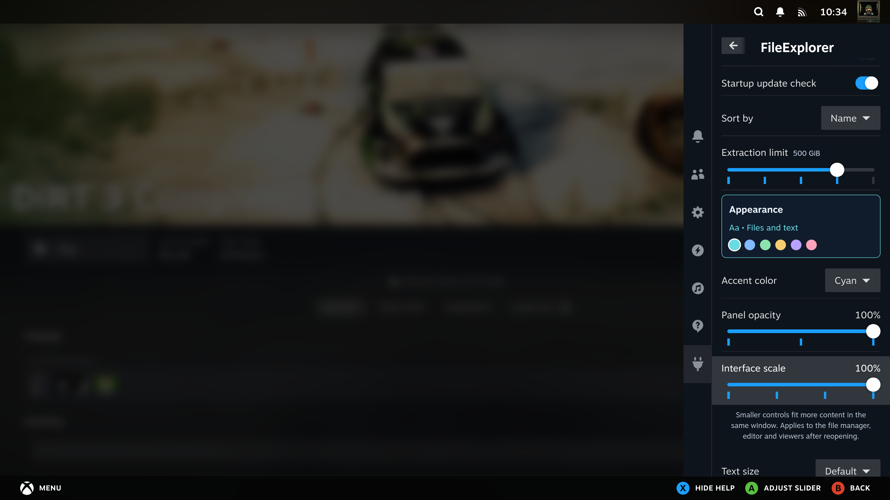
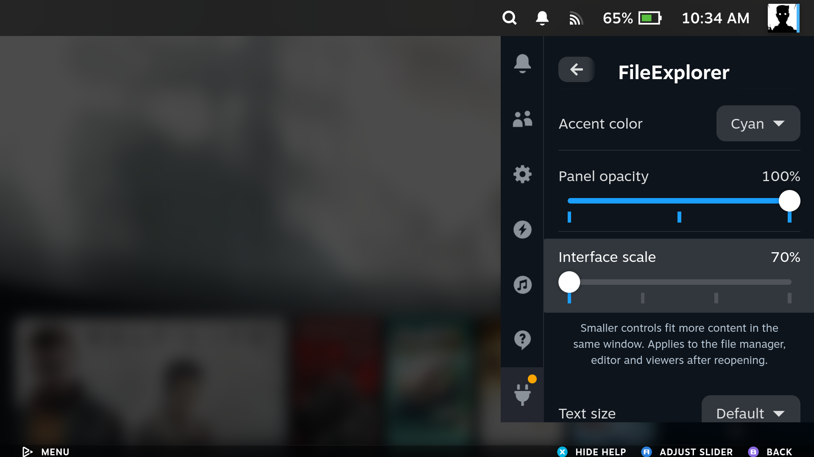
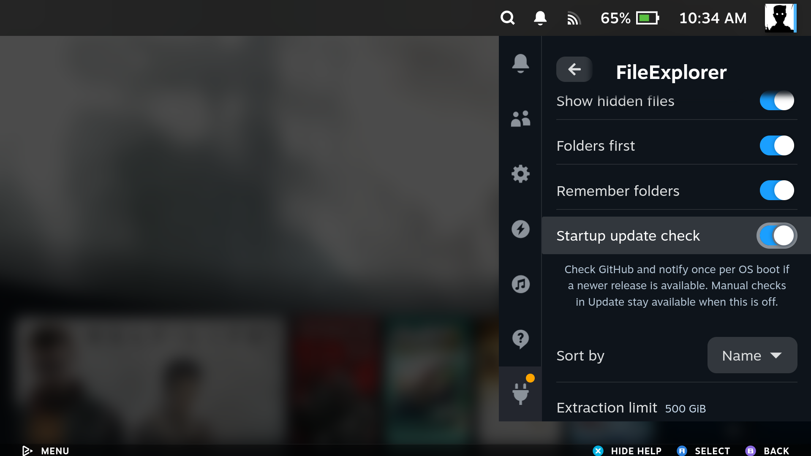
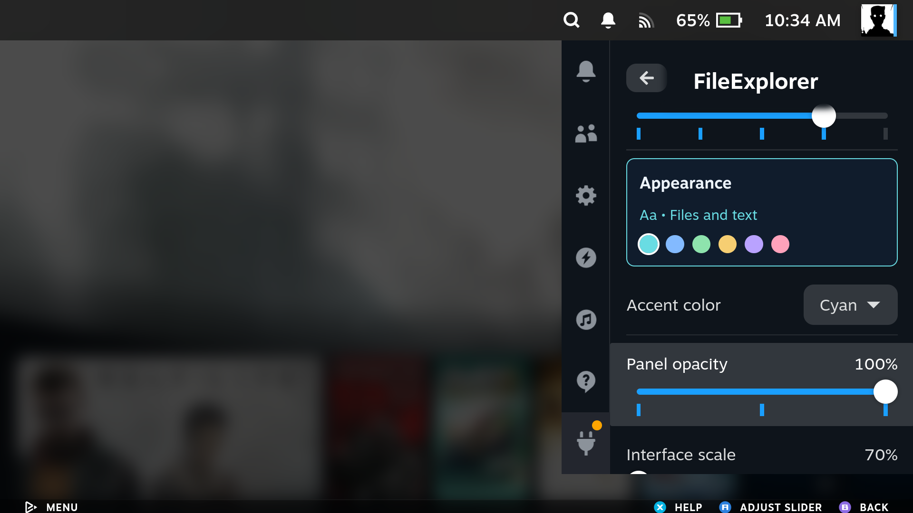
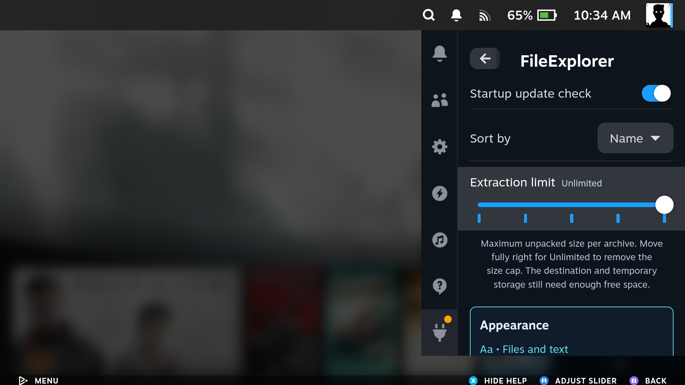
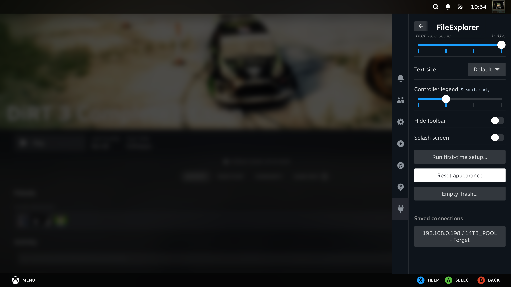
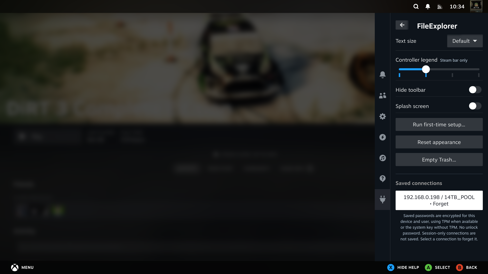
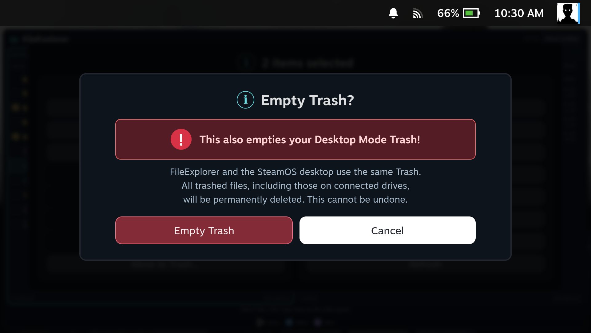
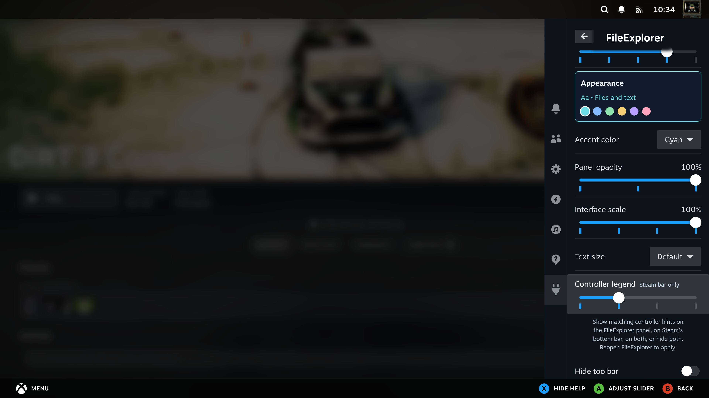
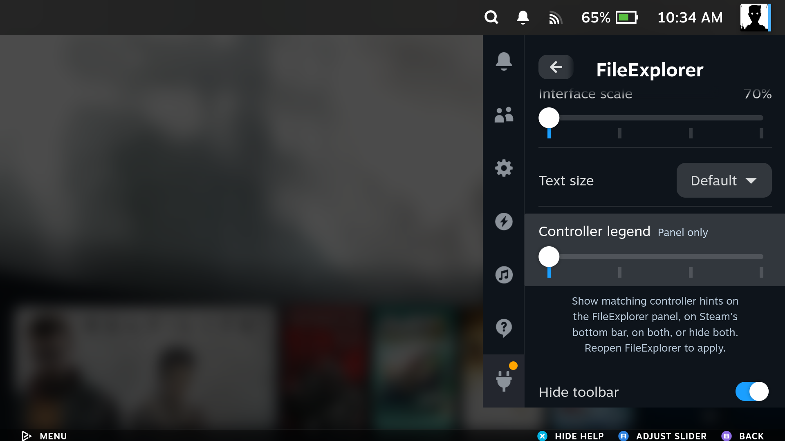

[Manual home](Home.md)

# Settings and Trash

Open **Decky → FileExplorer → Settings**. Settings stay inside the compact Decky
sidebar. Reopen or refresh the file manager to see changes in its listings.

**B** or **‹ Back** returns to FileExplorer's menu with **Settings** selected.
About and Update return to their respective menu entries in the same way.

With a setting focused, press **X** to show or hide its explanation. Moving
**up/down** closes the description. Help stays collapsed by default, leaving
the full row width for the setting. Panel opacity, interface scale, extraction
limit and controller legend use controller-friendly sliders; left/right changes their value.

| SteamOS PC | SteamOS handheld |
| --- | --- |
|  |  |

Sorting can also be changed directly through **Options → Sort by…** in the file
manager. It updates both panels immediately. See [dates and sorting](Daily-Use.md#dates-and-sorting).

## Settings reference

The [first setup](First-Setup.md) offers Handheld and Steam PC starting profiles.
The defaults below describe those profiles; older installations keep their
existing values until a profile is saved.

| Setting | Behavior | Default |
| --- | --- | --- |
| Show hidden files | Include dot names and SMB files with the hidden attribute | On in both profiles; Off on a fresh installation before saving a profile |
| Folders first | Group folders before files | On |
| Remember folders | Restore each panel's last path; when off, open both at Home | On |
| Startup update check | Check GitHub and notify about a newer release once per OS boot; manual Update checks remain available when off | On |
| Sort by | Name alphabetically, Size largest first, or Date modified newest first | Name |
| Extraction limit | Maximum unpacked archive size: 10, 50, 100 or 500 GiB; the rightmost slider position is Unlimited | 100 GiB |
| Accent color | Cyan, blue, green, amber, violet or rose | Cyan |
| Panel opacity | Background opacity: 70%, 85% or 100%; text stays opaque | 100% |
| Interface scale | 100%, 90%, 80% or 70% for controls in the file manager, editor, image viewer and media player; the window keeps its size | Handheld 70%; PC 100% |
| Text size | Small, Default, Large or Extra large in file rows and the editor | Default |
| Controller legend | Slider: Panel only, Steam bar only, Both or Hidden; both surfaces use the same active hints and order | Handheld: panel; PC: Steam bar |
| Hide toolbar | Start the file manager with its top button bar hidden; L3 changes and remembers this choice | Handheld: On; PC: Off |
| Splash screen | Show the centered startup image for three seconds on each launch; the first launch shows it once regardless | Off |
| First-time setup | Reopen the three-step profile chooser; nothing changes until Save | - |
| Reset appearance | Restore color, opacity, interface scale, text size and controller legend | - |
| Saved connections | Forget stored SMB profiles and their login details | None |

**Unlimited** removes the archive size cap for whole and selected extraction,
including downloaded SMB archives. Unsafe paths and links are still rejected.
The extraction limit is not a reservation of disk space. Make sure both the
destination and any temporary local storage have enough free space.

| SteamOS PC | SteamOS handheld |
| --- | --- |
|  |  |

| SteamOS PC | SteamOS handheld |
| --- | --- |
|  |  |

Appearance settings apply to both file panels and the text editor. Reopen a panel
after changing them. Background opacity leaves the text and icons fully opaque.
**Reset appearance** only resets these appearance options.

For more room on a handheld, try **Interface scale → 80%**, then reopen
FileExplorer. Scaling affects buttons, headers, legends and content together.
**Text size** adjusts file rows and editor text separately. In the editor,
**L3** hides or shows the toolbar without closing the keyboard.

Compare the [100% and 80% handheld screenshots](Handheld-Gallery.md).

Reset appearance, Empty Trash and Saved connections have separate spacing.
Focus a saved connection and press **X** to read what forgetting it does.
Saved SMB passwords are encrypted without a wallet unlock prompt. The Forget
confirmation also shows whether the password uses TPM, the system key, or is
kept for this session only. Storage or migration failures appear as an explicit
warning. See [Network shares](Network-Shares.md#remember-or-forget-a-connection)
for fallback and recovery details.

## Move local files to Trash

Select local files or folders, then choose **Options → Move to Trash** and confirm.
You can restore them from Trash in Desktop Mode. If Trash is unavailable for that
location, the operation stops instead of switching to permanent deletion.

Items on a **direct SMB connection** use **Delete permanently** instead. The
confirmation explains that this cannot be undone. FileExplorer provides no
restore operation for those deletions.

## Empty Trash

Choose **Empty Trash…** from Settings or the file manager's Options menu.

| SteamOS PC | SteamOS handheld |
| --- | --- |
|  |  |

**This also empties your Desktop Mode Trash**, including your Trash on connected
drives. FileExplorer and the desktop use the same Trash; this is not a separate
plugin-only bin. Confirming permanently deletes the trashed items. Choose
**Cancel** to leave them there.

Emptying is available during unrelated transfers. If an earlier operation is
using Trash, emptying waits until that operation finishes. Inaccessible system
partitions are skipped when locating Trash; errors deleting items from an
accessible Trash are still reported.

## Controller legend

Choose panel hints, the Steam bar, both or neither. Hiding both leaves more room
for files; closing FileExplorer restores Steam's normal controls.

| SteamOS PC | SteamOS handheld |
| --- | --- |
|  |  |
|  |  |
