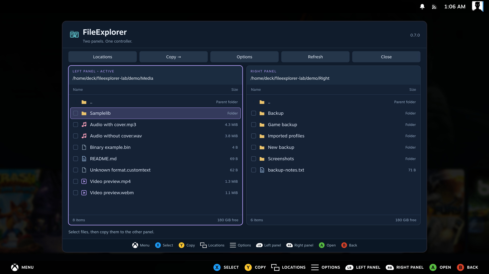

[Manual home](Home.md)

# Supported formats

Press **A** to open a supported file. Files outside the recognized categories
remain selectable for copying, renaming and other file actions.

| Type | Recognized formats | What opens |
| --- | --- | --- |
| Audio (12 extensions) | `mp3`, `mp2`, `wav`, `wave`, `flac`, `ogg`, `oga`, `opus`, `m4a`, `m4b`, `aac`, `weba` | Player with embedded cover or speaker icon |
| Video (6 extensions) | `mp4`, `m4v`, `mov`, `webm`, `ogv`, `mkv` | Player with seek, pause and fullscreen |
| Images | BMP, PNG/APNG, JPG/JPEG/JPE/JFIF, GIF, WebP | Image viewer; previous/next picture |
| Archives | ZIP, RAR, 7z, TAR, GZ, BZ2, XZ, TGZ, TBZ/TBZ2, TXZ | Browse and extract files |
| Text (238 extensions, plus known filenames) | TXT, LOG, CFG/INI/CONF, JSON, YAML, TOML, XML, Markdown, CSV/TSV, subtitles, source code and more | Plain-text editor, preserving original formatting |

Media playback depends on the codecs inside the file. When needed, system FFmpeg
provides compatibility playback, up to 720p/30 fps for video. A filename extension
alone does not guarantee that every encoded file will play.

PDF, DOC/DOCX, XLS/XLSX, PPT/PPTX and ODT/ODS/ODP are **not displayed as documents**.
HTML, SVG, RTF, Markdown and notebook files open as **source text**, without page
layout or rich formatting. Unknown text extensions can use **Options → Edit file**;
binary data is rejected. Opening a script never executes it.

## Complete text extension list

These 238 extensions are recognized case-insensitively. They describe
text files, not separate rich-document renderers. The editor accepts files up to
512 KiB and 10,000 lines, preserves indentation, blank lines, encoding and line
endings, and validates JSON before saving. Other formats are preserved without
automatic reformatting; their syntax is not automatically validated.

`acf`, `adoc`, `ansible`, `asc`, `asciidoc`, `asm`, `ass`, `astro`, `automount`, `awk`, `bash`, `bashrc`, `bat`, `bb`, `bbappend`, `bbclass`, `bib`, `browserslistrc`, `c`, `cc`, `cer`, `cfg`, `cjs`, `clj`

`cljc`, `cljs`, `cls`, `cmake`, `cmd`, `comp`, `compute`, `conf`, `config`, `containerfile`, `cpp`, `crt`, `cs`, `csh`, `css`, `csv`, `cts`, `cue`, `curlrc`, `cxx`, `d`, `dart`, `desktop`, `diff`

`dockerfile`, `dockerignore`, `editorconfig`, `edn`, `env`, `erl`, `ex`, `exs`, `fish`, `frag`, `fs`, `fstab`, `fsx`, `gd`, `gdshader`, `gemspec`, `geojson`, `geom`, `gitattributes`, `gitconfig`, `gitignore`, `gitmodules`, `glsl`, `go`

`godot`, `gql`, `gradle`, `graphql`, `groovy`, `h`, `hcl`, `hh`, `hlsl`, `hosts`, `hpp`, `hrl`, `hs`, `htaccess`, `htm`, `html`, `htoprc`, `hxx`, `inc`, `inf`, `ini`, `inputrc`, `inventory`, `ipynb`

`java`, `jl`, `js`, `json`, `json5`, `jsonc`, `jsonl`, `jsx`, `ksh`, `kt`, `kts`, `less`, `lhs`, `lock`, `log`, `lrc`, `lua`, `luau`, `m`, `m3u`, `m3u8`, `mak`, `make`, `manifest`

`markdown`, `md`, `mdown`, `mdx`, `mjs`, `mk`, `mkd`, `mm`, `mod`, `mount`, `mts`, `nanorc`, `ndjson`, `nim`, `nix`, `npmrc`, `nvmrc`, `org`, `pas`, `patch`, `path`, `pem`, `php`, `phtml`

`pl`, `plist`, `pls`, `pm`, `po`, `pot`, `pp`, `profile`, `prop`, `properties`, `proto`, `ps1`, `psd1`, `psm1`, `pub`, `py`, `pyi`, `pyw`, `r`, `rake`, `rb`, `recipe`, `reg`, `rmd`

`rs`, `rst`, `rtf`, `rules`, `s`, `sass`, `scala`, `scope`, `screenrc`, `scss`, `sdl`, `sed`, `service`, `sh`, `shader`, `slice`, `socket`, `spec`, `sql`, `srt`, `ssa`, `sty`, `sum`, `svelte`

`svg`, `swift`, `tab`, `target`, `tcl`, `tesc`, `tese`, `tex`, `text`, `tf`, `tfvars`, `timer`, `toml`, `tres`, `ts`, `tscn`, `tsv`, `tsx`, `txt`, `udev`, `unity`, `url`, `urls`, `v`

`vala`, `vb`, `vdf`, `vert`, `vimrc`, `vmt`, `vtt`, `vue`, `webloc`, `wgetrc`, `xaml`, `xhtml`, `xml`, `xsd`, `xsl`, `xslt`, `yaml`, `yarnrc`, `yml`, `zig`, `zsh`, `zshrc`

## Recognized filenames

`.bash_logout`, `.bash_profile`, `.bashrc`, `.dockerignore`, `.editorconfig`, `.env`, `.gitattributes`, `.gitconfig`, `.gitignore`, `.gitmodules`, `.nanorc`, `.npmrc`, `.nvmrc`, `.profile`, `.tmux.conf`, `.vimrc`, `.yarnrc`, `.zprofile`, `.zshrc`, `authors`, `brewfile`, `bsdmakefile`, `changelog`, `changes`, `cmakelists.txt`, `config`, `configure`, `containerfile`, `contributors`, `copying`, `copyright`, `dockerfile`, `fstab`, `gemfile`, `gnumakefile`, `group`, `hostname`, `hosts`, `install`, `jenkinsfile`, `justfile`, `licence`, `license`, `makefile`, `meson.build`, `meson_options.txt`, `news`, `notice`, `passwd`, `procfile`, `rakefile`, `readme`, `resolv.conf`, `shadow`, `todo`, `vagrantfile`

README, LICENSE/LICENCE, COPYING, CHANGELOG, AUTHORS and NOTICE may also have
a simple suffix. `.env.*`, `Dockerfile.*` and `Containerfile.*` variants are
recognized. An unrecognized name can still use **Options → Edit file** if its
contents pass the text checks.

## Locations and limits

- Local files and direct SMB shares use the same recognized categories.
- Images can also be previewed inside supported archives. Extract audio and
  video before playing, and text files before editing. Archive browsing is read-only.
- A plain GZ, BZ2 or XZ stream appears as one member named `data`. TAR compression
  retains the archive's normal names and folders.
- Extraction follows the limit selected in Settings, with an unlimited option.
  Symlinks and unsafe archive paths are rejected.

For controls, see [Audio and video](Media-Player.md), [Text editor](Text-Editor.md)
and [Copy and background jobs](Copy-and-Background-Jobs.md). Test evidence and
its limits are recorded in [Testing](https://github.com/60plus/Decky-FileExplorer/blob/main/docs/TESTING.md).

## File type icons

| SteamOS PC | SteamOS handheld |
| --- | --- |
|  |  |
